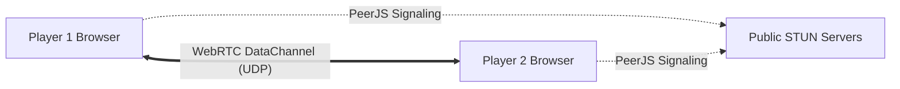

# 🌐 Multiplayer & Netcode / 联机与回滚同步

## WebRTC Peer-to-Peer Architecture (免服务器点对点架构)

RenYing uses serverless **WebRTC DataChannels** directly between client browsers:

- **Zero Server Costs**: Match data and input packets do not pass through game servers.
- **NAT Traversal**: Automatic handshake using standard public STUN servers.

---

## Deterministic Rollback (确定性回滚网络)

To eliminate input lag across network latency:
1. Both clients run the simulation locally at 60 FPS using identical random seeds.
2. Inputs are exchanged frame-by-frame via UDP.
3. When remote input arrives late, the engine snaps back to the diverged frame, replays historical actions deterministically, and resynchronizes the scene seamlessly without visual hitching.
4. Continuous frame checksums (`tools/rollback-test.mjs`) guarantee zero desync drift.
