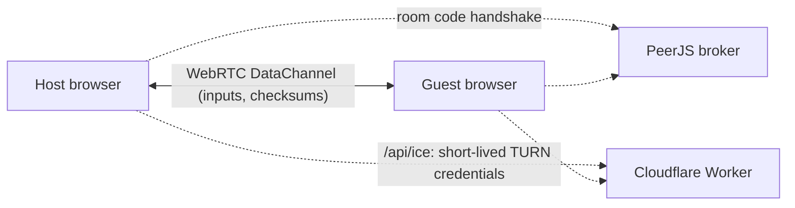

# Multiplayer And Netcode / 联机与回滚同步

## The Short Version / 一句话

Two browsers connect directly, run the same simulation and exchange only button presses. When a press arrives late, the game quietly rewinds a few frames, replays them with the right input and catches up. That is why online matches feel close to local ones.

两个浏览器直接相连，各自算同一局，只互相发按键；某一帧的按键来晚了，就悄悄退回几帧用正确的按键重算再追上。所以联机手感接近本机。

## Connection / 连接

1. The host creates a room. The 4-character room code is registered with the PeerJS broker, which only introduces the two browsers.
2. Both sides gather network candidates with public STUN servers and open a WebRTC DataChannel directly.
3. On networks that block direct links (school, office, symmetric NAT) the page asks the Worker for short-lived TURN credentials and relays through TURN instead. Without the Worker (offline edition, server down) only STUN is used.
4. Both sides must run the same game version (`VERSION` in `src/game/01-core.js`); a mismatch is reported before the match starts.

Code: `src/net-p2p.js` (connection), `src/game/06-input-net.js` (inputs), `src/game/20-tutorial-rollback-touch.js` (rollback and resync).

## Rollback / 回滚

- The game logic runs at a fixed **120 steps per second** (`STEP` in `src/game/01-core.js`), independent of the screen refresh rate.
- Everything that affects the match uses a seeded random generator (`grnd()`), never `Math.random`. Visual-only effects may differ between the two sides; the fight itself may not.
- Each side keeps recent snapshots of the match state in a ring buffer. When a remote input arrives for a past frame, the game restores that snapshot, re-simulates up to the present with the correct input (`RESIM`), and draws the result.
- Platforms, wind, lightning, clones, puppet balls and every other piece of match state live in the snapshot, so maps and summons rewind correctly too.
- The two sides compare a state checksum periodically. On a mismatch the host sends its full state and the guest adopts it, so the match carries on in sync.

所有影响对局的随机数都用同一个种子；最近的每一帧都存着快照，远端按键晚到就恢复快照重算；双方定期比对校验和，对不上时房主把整份状态发过去，对方直接采用。

## Room Types / 房间类型

Room rules are listed in `ROOM_MODES` in `src/data/10-modes.js`:

| Room | Players | Notes |
| :--- | :--- | :--- |
| `normal` | 1 vs 1 | 3v3 relay with snake draft |
| `chaos`, `mayhem`, `maps` | 1 vs 1 | Special rules; in `maps` both sides vote for the map |
| `pp_cc` | 2 humans vs 2 AI | 2v2 co-op |
| `pp_pp` | 2 vs 2 humans | Four browsers |
| `raid` | Host + friend + AI ally vs boss | Co-op raid |

Matchmaking and ranked queues run on the Worker; once two players are matched, the match itself is still peer-to-peer.

## The Open World Server / 开放世界服务器

The open world (江湖共斗) is different: it runs on the server.

- Each **world line** is one Cloudflare Durable Object holding up to 40 players. When a line is full, new players go to the next line, so there is no total limit. You can type a line number to join a friend.
- Monsters and the world boss run on the server. Each browser simulates only its own hero, so controls feel like single player.
- Each player only receives players and monsters within 2,000 px. The server caps damage per hit and per second.
- The server-wide story (江湖长卷) is one shared row in D1. Lines report contributions every 20 seconds; a report sent twice counts once.

## Testing / 测试

| Command | Checks |
| :--- | :--- |
| `node tools/rollback-test.mjs --rollback` | Snapshot, restore and re-simulation give identical results |
| `node tools/netplay-test.mjs` | Two game copies over a laggy, jittery link end every match identically |
| `node tools/world-test.mjs` | Open world line: player cap, view range, damage caps, world boss, restarts |
