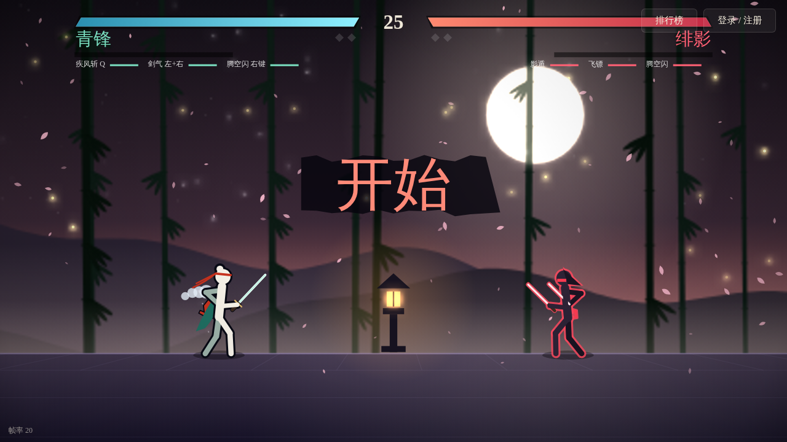
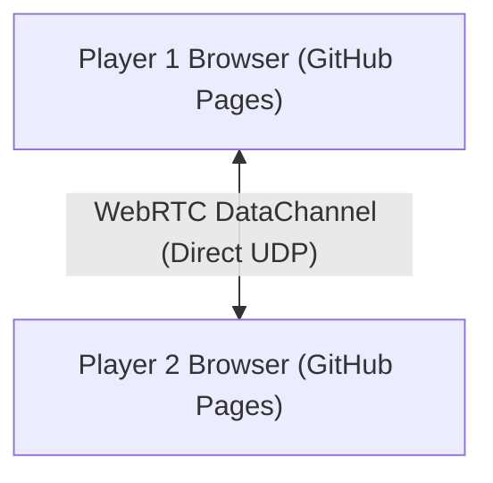

# ⚔ RenYing

<div align="center">



**An ink-wash martial-arts duel game that runs in a browser tab**  
*By Even, Luffy, and Opus 5.5. Plain JavaScript and canvas, serverless WebRTC multiplayer, and an optional zero-dependency Python server.*

[](https://amfi-disable.github.io/RenYing/)
[](https://python.org)
[](https://html.spec.whatwg.org)
[](#architecture-and-technical-anatomy)
[](https://github.com/AMFI-Disable/RenYing/releases)
[](license)
[](#privacy-and-security-first)
[](#overview-and-core-value)

</div>

---

## 🌐 Select Language / 选择语言

**[English](readme.md)** •
**[简体中文](readme.zh-cn.md)**

---

## 🧭 Table Of Contents

- [Overview And Core Value](#overview-and-core-value)
- [Key Features](#key-features)
- [Game Controls And Mechanics](#game-controls-and-mechanics)
- [How To Play And Multiplayer Modes](#how-to-play-and-multiplayer-modes)
- [Architecture And Technical Anatomy](#architecture-and-technical-anatomy)
- [Project Structure And Building](#project-structure-and-building)
- [Privacy And Security First](#privacy-and-security-first)
- [Educational And Fair-Play Disclaimer](#educational-and-fair-play-disclaimer)
- [License And Legal Attribution](#license-and-legal-attribution)

---

## ⚡ Overview And Core Value <a id="overview-and-core-value"></a>

**RenYing (刃影)** is a fast ink-wash martial-arts duel game. Twelve characters fight on one stage, each with their own reach, weight and tricks. It is built to be played right away — at school or at home: two browsers connect **directly** to each other over WebRTC, with nothing to host and nothing to install.

---

## 🚀 Key Features <a id="key-features"></a>

- **Plays from a URL** — open the GitHub Pages link and start. No install, no clone, no hosting.
- **Serverless P2P multiplayer** — share a 4-character room code and the two browsers connect directly over a WebRTC DataChannel, with rollback netcode to keep the fight responsive.
- **Armory & Marketplace (武库与集市)** — open weapon cases with ink, trade collectibles with other players, use trade-up contracts, or equip skins tiered from Standard to Legendary with automatic highest-tier equipping.
- **Bilingual Interface** — seamless English and Simplified Chinese support with persistent preferences and in-game toggle.
- **Drawn in code, not sprites** — brushstroke trails, scarf motion, hit-stop, screen shake and the whole ink-wash look are drawn procedurally on a 2D canvas.
- **Single-file offline build** — `renying-offline.html` opens by double-click, with the music and the Qingfengxing mini-game packed inside it.

---

## 🎮 Game Controls And Mechanics <a id="game-controls-and-mechanics"></a>

### Default Keyboard And Mouse Controls

| Action | Input |
| :--- | :--- |
| **Move left / right** | `A` / `D` |
| **Jump / double jump** | `W` or `Space` |
| **Block** | Hold `S` |
| **Attack (5-hit combo)** | Left mouse button |
| **Charged slash** | Hold the left mouse button, then release |
| **Ranged attack** | Hold the left mouse button, then right-click (or `R`) |
| **Escape (dodge upward)** | Right-click (or `Left Shift`) |
| **Skill / ultimate** | `Q` / `E` (the ultimate needs a full meter) |
| **Pause / mute** | `P` / `M` (single-player) |

*On a phone or tablet the game switches to its own touch controls — a virtual stick on the left, action buttons on the right — and asks you to turn the device sideways.*

---

## 📦 How To Play And Multiplayer Modes <a id="how-to-play-and-multiplayer-modes"></a>

### Option 1: Direct WebRTC (Best For School — No Budget Needed)

Nothing to install and no server to run:

1. Both players open **[https://amfi-disable.github.io/RenYing/](https://amfi-disable.github.io/RenYing/)**.
2. Player 1 goes to **联机对战**, clicks **建房**, and shares the 4-character room code it shows (for example `K7PQ`).
3. Player 2 types that code into **加入** and clicks **加入**.
4. From then on the two browsers talk straight to each other over a WebRTC DataChannel; PeerJS is only used to introduce them.

Some networks — campus Wi-Fi in particular — block peer-to-peer traffic. If joining times out, try another network.

### Option 2: Standalone Offline Play

Open `renying-offline.html` directly — double-click it, with no server and no internet connection. The music and the Qingfengxing mini-game are inside that single file.

---

## 🏗 Architecture And Technical Anatomy <a id="architecture-and-technical-anatomy"></a>



- **Client runtime** — vanilla JavaScript drawing to a single HTML5 canvas. No framework, no bundler.
- **Rollback netcode** — both sides simulate the whole match deterministically and exchange only their inputs. If an input arrives late, that side reloads the stored frame, replays it with the correct input and catches back up; the two sides also compare a state checksum periodically to catch any drift.
- **P2P networking** — WebRTC DataChannels, with PeerJS for the handshake and public STUN servers for NAT traversal (`src/net-p2p.js`).
- **Persistence** — `localStorage` in the browser, plus cloud accounts and saves on a Cloudflare Worker with D1 (`cloudflare/`).

---

## 🧱 Project Structure And Building <a id="project-structure-and-building"></a>

Edit the sources; never edit the generated pages.

| Path | Purpose |
| :--- | :--- |
| `src/page.html` | Page markup with build markers |
| `src/style.css` | All styles |
| `src/i18n.js` | Bilingual internationalization engine and vocabulary dictionary |
| `src/game/` | Game engine, 12-character roster, menus, combat states and rollback netcode, split into 25 numbered files (`02-heroes.js`, `03-skills.js`, `10-hits.js` …) that build.py concatenates in order |
| `src/armory-core.js` | Weapon cases, rarity tiers, skins catalog, and inventory calculations |
| `src/armory.js` | Armory UI, unboxing animations, trade-up contracts, and marketplace views |
| `src/anticheat.js` | Anti-cheat state integrity, rate limiting, and damage verification |
| `src/net-p2p.js` | Serverless WebRTC direct connection |
| `src/cloud.js` | Cloud save synchronization, account merge, and signed local backup/restore |
| `src/social.js` | Serverless WebRTC P2P community hub, friends, and live spectating |
| `src/qfx/` | Modular source files for the Qingfengxing mini-game |
| `cloudflare/` | Cloudflare Worker backend with D1 database for account sync, economy, and admin console |
| `assets/music/` | Background music (`.mp3`) |
| `assets/qingfengxing.html` | Generated Qingfengxing mini-game page |
| `tools/build.py` | Generates the pages below (Python standard library only) |
| `tools/combat-test.mjs` | Headless/in-process regression suite for all 12 heroes, 2v2 AI, and combat state transitions |
| `tools/econ-test.mjs` | Economy, armory, market, drop rates, and anti-abuse test suite (389 checks) |
| `tools/rollback-test.mjs` | Rollback determinism and frame replay verification |
| `tools/simulate-all.mjs` | Multi-threaded simulation, counter audit, and neural policy training pipeline |
| `tools/ui-audit.mjs` | Headless check that every panel fits, with nothing clipped or too small to read |
| `tools/hud-audit.mjs` | Headless check that no in-match HUD text is drawn below 12px |
| `tools/hud-overlap-audit.mjs` | Headless check that HUD text and bars never overlap or run off-canvas |
| `tools/touch-audit.mjs` | Emulates phones and tablets, then drives the touch controls |
| `index.html` | Generated online edition (GitHub Pages) |
| `renying-offline.html` | Generated single-file offline edition |
| `renying.html` | Generated redirect for the old address |

After changing anything in `src/` or `assets/`, rebuild and commit the generated pages together with the sources:

```bash
python3 tools/build.py
```

CI runs `python3 tools/build.py --check` and fails if the generated pages are out of date. It also runs the economy tests, the combat and AI regression suite, and the panel, HUD and touch audits.

---

## 🛡 Privacy And Security First <a id="privacy-and-security-first"></a>

- **No telemetry** — no analytics, no trackers, no crash reporting.
- **Peer-to-peer stays peer-to-peer** — in WebRTC mode your inputs travel straight to the other player's browser and never pass through a server.
- **Your data stays on your machine** — match history, ladder statistics and replays live in your browser's local storage, or in `data/renying.db` on the machine running the server.

---

## ⚖ Educational And Fair-Play Disclaimer <a id="educational-and-fair-play-disclaimer"></a>

> [!CAUTION]
> **Notice**:
> This codebase is meant for learning, research and non-commercial play.
> Please keep multiplayer matches and community chat friendly.
> The authors are not responsible for third-party hosting or for servers other people run.

---

## 📄 License And Legal Attribution <a id="license-and-legal-attribution"></a>

Created by **Even, Luffy, and Opus 5.5**. Licensed under the [MIT License](license). Copyright (c) 2026 AMFI-Disable, Even, Luffy, and Opus 5.5.
