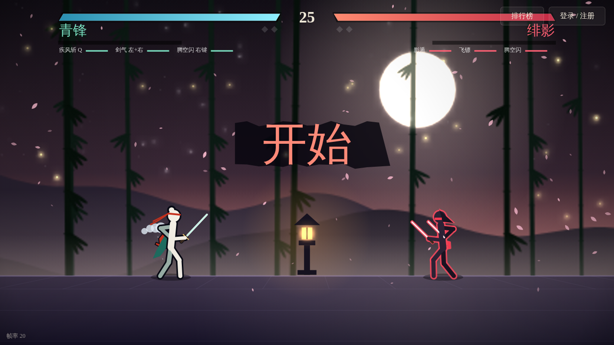
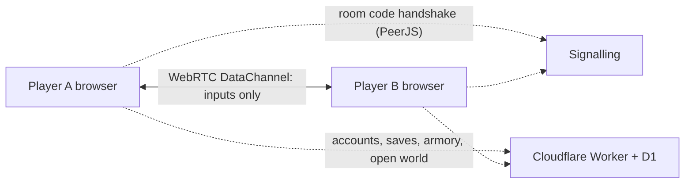

# ⚔ RenYing

<div align="center">



**An ink-wash martial-arts fighting game that runs in a browser tab.**  
*Made by Even, Luffy, Opus 5.5 and Gemini 4 Argon. Plain JavaScript on one canvas, peer-to-peer online play, and an optional Cloudflare Worker for accounts.*

[](https://amfi-disable.github.io/RenYing/)
[](changelog.md)
[](#heroes)
[](#how-it-works)
[](#how-it-works)
[](license)

**[English](readme.md)** • **[简体中文](readme.zh-cn.md)** • **[Wiki](https://github.com/AMFI-Disable/RenYing/wiki)**

</div>

---

## Contents

- [What It Is](#what-it-is)
- [Play It](#play-it)
- [Controls](#controls)
- [Modes](#modes)
- [Heroes](#heroes)
- [Armory](#armory)
- [How It Works](#how-it-works)
- [Repository Layout](#repository-layout)
- [Building And Testing](#building-and-testing)
- [Contributing](#contributing)
- [Privacy](#privacy)
- [License](#license)

---

## What It Is

**RenYing (刃影)** is a fast 2D fighting game drawn in an ink-wash style. Sixteen heroes, each with their own reach, weight, passive and three skills, fight one-on-one, in 2v2 teams or in 3v3 relay matches. Everything on screen, from brush trails to scarves and hit flashes, is drawn in code on a single canvas; there are no sprite sheets.

The game is made for playing with friends straight away. Open the link, share a four-character room code, and the two browsers connect directly to each other. There is also a single-file offline edition that works with no network at all.

The game is bilingual: Simplified Chinese and English, switchable at any time from the top bar or settings.

---

## Play It

| Way | How |
| :--- | :--- |
| **Online** | Open <https://amfi-disable.github.io/RenYing/> in Chrome, Edge, Safari or Firefox. Nothing to install. |
| **Offline** | Download `renying-offline.html` and double-click it. Music and the 青锋行 (Qingfengxing) mini-game are packed inside the one file. Online modes and accounts are not available offline. |
| **Phone or tablet** | Open the same link and turn the device sideways. Touch controls appear automatically. |

### Playing With A Friend

1. Both players open the game.
2. One player opens **联机 / Online**, creates a friend room and shares the room code (for example `K7PQ`).
3. The other player types the code and joins.

Inputs then go straight from one browser to the other. On networks that block peer-to-peer traffic (some school or office Wi-Fi), the game asks the server for a relay so the match still connects.

---

## Controls

Default keyboard and mouse layout for player 1. Every key can be changed in **设置 / Settings**.

| Action | Mouse | Keyboard |
| :--- | :--- | :--- |
| Move | | `A` / `D` |
| Jump, double jump | | `W` or `Space` |
| Block (hold), drop through a platform (`↓` + jump) | | `S` |
| Attack, 5-hit combo | Left click | `X` |
| Charged slash | Hold left click, release | Hold `X`, release |
| Skill 1 | | `Q` |
| Skill 2 | Hold left click, then right click | `R` |
| Ultimate (needs a full meter) | | `E` |
| Escape (腾空闪) | Right click | `Left Shift` |
| Pause / mute | | `P` / `M` |

- **Keyboard only:** every menu, dialog, the draft screen and the results screen work with the arrow keys or WASD, `Enter`/`Space` to press and `Esc` to go back. A gold frame shows the selection.
- **Same computer, several players:** players 2 to 4 have their own key blocks (arrows + `UIOJK`, `TFGH` + `CVBNM`, and the number pad).
- **Touch:** a virtual stick on the left and action buttons on the right.

---

## Modes

| Mode | What you do |
| :--- | :--- |
| **演武 · Play vs AI** | Duel the computer at six levels, from 入门 (Easy) to 天道 (Transcendent). Pick the arena and a rule set. |
| **天机乱斗 · Chaos** | A new random mutation hits the arena every 15 seconds. |
| **通天神决 · Mayhem** | Ten times the meter, no cooldowns and doubled skill power for everyone. |
| **山河异境 · Terrain Clash** | Six maps with platforms, ice, wind and lightning; the map is chosen by vote. |
| **3v3 车轮战 · Relay** | Three heroes per side, snake draft; the round winner carries over their remaining health. |
| **2v2** | Two players against two AIs, or two players against two players, on one computer or online. |
| **守关挑战 · Stages** | Stage chapters with star ratings and rewards. |
| **侠客列传 · Hero Chronicles** | A branching story for every hero, with choices and two endings. |
| **问剑密卷 · Sword Pagoda** | Climb a tower and build a run from scrolls. |
| **同袍肉鸽 · Co-op Raid** | 2 to 3 players share scrolls and healing against a fused boss. |
| **江湖共斗 · Open World** | A shared 24,000 px world with eight zones, a world boss and a server-wide story. Up to 40 players per line. |
| **天魔讨伐 · Demon Raid** | A server-wide boss fight. |
| **联机 · Online** | Quick match, ranked play and friend rooms, plus 2v2, raid and special rules. |
| **木人桩 · Dummy** | Free practice against a training dummy. |
| **观战与回放 · Watch and Replays** | Watch AI exhibitions, save and import replays. |
| **青锋行 · Qingfengxing** | A separate 3D action mini-game, solo or 2 to 4 player co-op. |

Some modes (ranked, open world, Demon Raid, the armory market) need the server and a signed-in account. Everything else also works as a guest.

---

## Heroes

Sixteen heroes. Each has a passive, a skill on `Q`, a second skill on `R` and an ultimate on `E`.

| Hero | Style | Q | R | E |
| :--- | :--- | :--- | :--- | :--- |
| 青锋 Qing Feng | Wandering Swordsman | 疾风斩 Gale Slash | 剑气 Sword Qi | 残月 Crescent Moon |
| 绯影 Fei Ying | Shadow Assassin | 影遁 Shadow Blink | 飞镖 Kunai Star | 千影 Thousand Shadows |
| 铁山 Tie Shan | Heavy Iron Armor | 震地 Earthquake | 铁壁冲 Iron Wall Charge | 山崩 Avalanche |
| 凌霜 Ling Shuang | Frost Spear Champion | 回马枪 Back Thrust | 枪旋 Spear Whirl | 刹那 Time Freeze |
| 流云 Liu Yun | Wind Walker | 风刃 Wind Blade | 开扇 Fan Flourish | 龙卷 Tornado Storm |
| 雷鸣 Lei Ming | Thunder Monk | 雷闪 Thunder Fist | 金刚雷铠 Vajra Armor | 雷霆万钧 Thunderstruck |
| 墨羽 Mo Yu | Ink Painter | 墨阵 Ink Trap | 画符 Talisman Brush | 符阵 Talisman Array |
| 月华 Yue Hua | Moon Mirror Master | 月镜 Moon Mirror | 月轮 Moon Chariot | 月华如水 Moonlight Cascade |
| 燕翎 Yan Ling | Sky Swallows | 俯冲 Falcon Dive | 翎羽 Feather Darts | 万羽 Feather Storm |
| 玉箫 Yu Xiao | Flute Musician | 清音 Clear Tone | 回音壁 Echo Barrier | 广陵散 Guangling Verse |
| 醉翁 Zui Weng | Drunken Hermit | 亭中留客 Pavilion Trap | 与民同乐 Wine Feast | 山水之间 Landscape Domain |
| 勾陈 Gou Chen | Chain Hammer Wanderer | 飞锤 Chain Hook | 旋锤 Hammer Whirl | 开天一锤 Heavensplitter |
| 凌雀 Ling Que | Shuttle Wanderer | 穿叶飞梭 Leaf-Piercing Shuttle | 移形换影 Shadow Swap | 万线归宗 Thousand Threads |
| 离影 Li Ying | Soul-Parted Blade | 留影 Mist Mark | 渡影 Mist Crossing | 万影归一 Myriad Mists |
| 磁仙 Ci Xian | Two-Pole Adept | 极性反转 Pole Swap | 磁极 Magnet Poles | 天地磁合 Heaven-Earth Clamp |
| 千机 Qian Ji | Puppet Engineer | 投丸 Ball Throw | 暴雨梨花 Needle Burst | 千丝收网 Silk Recall |

Full move lists and frame data: [wiki: Heroes And Combat](https://github.com/AMFI-Disable/RenYing/wiki/Heroes-and-Combat) and [docs/frame-data.md](docs/frame-data.md).

---

## Armory

The armory (武库) is the game's cosmetic collection. Skins and weapon looks never change how a hero plays.

- **Ink (墨锭)** is the only currency. It is earned by playing (daily and weekly tasks, stages, stories). There is no real-money shop.
- **Weapon cases (武器箱)** hold a set of skins in five quality tiers. Each case can be opened a limited number of times per day or week.
- **Kill-count editions (斩数版)** record how many knockouts the skin has made.
- **Reforge pacts (熔铸契)** turn ten items of one tier into one item of the next tier.
- **Player market (玩家市场)** lets players list items for Ink; a fee is removed from each sale so Ink does not pile up.
- **Peddler (货郎)** shows one offer at a time at a fixed price.

Every armory action on a cloud account is checked and recorded by the server. Details: [wiki: Armory](https://github.com/AMFI-Disable/RenYing/wiki/Armory-and-Marketplace).

---

## How It Works



- **Client:** vanilla JavaScript drawing on one HTML5 canvas. No framework, no bundler, no runtime npm packages. The game logic runs at a fixed 120 steps per second.
- **Rollback netcode:** both browsers simulate the match with the same seed and exchange only inputs. A late input makes that side rewind to the stored frame, replay with the correct input and catch up. Periodic state checksums catch any drift.
- **Connection:** WebRTC DataChannels with PeerJS for the handshake and public STUN servers; the Worker can hand out short-lived TURN credentials for networks where a direct link fails.
- **Server (optional):** a Cloudflare Worker with a D1 database for accounts, cloud saves, the armory economy, leaderboards and the open world (a Durable Object per world line). The game still works without it.
- **Generated pages:** `tools/build.py` joins the sources in `src/` into `index.html` (online) and `renying-offline.html` (single file, offline).

More in the wiki: [Multiplayer And Netcode](https://github.com/AMFI-Disable/RenYing/wiki/Multiplayer-and-Netcode) and [Architecture And Development](https://github.com/AMFI-Disable/RenYing/wiki/Architecture-and-Development).

---

## Repository Layout

| Path | What it is |
| :--- | :--- |
| `src/page.html`, `src/style.css`, `src/styles/` | Page markup (with build markers) and styles joined in filename order |
| `src/game/` | The game, split into numbered files that `tools/build.py` joins in order |
| `src/data/` | Data tables: one file per hero in `src/data/heroes/`, modes, draft orders, maps, AI levels, English UI text. Checked at build time by `tools/checks/data-check.mjs` |
| `src/ai.js` | Computer opponents |
| `src/net-p2p.js` | Peer-to-peer connection |
| `src/cloud.js` | Accounts and cloud saves |
| `src/armory-core.js`, `src/armory.js` | Armory rules and armory screens |
| `src/anticheat.js` | Client-side integrity checks |
| `src/social.js`, `src/errlog.js`, `src/i18n.js` | Community features, error reports, translation lookup |
| `src/qfx/` | Sources of the 青锋行 mini-game |
| `assets/` | Music, the generated mini-game page, vendored `peerjs` and `three.js` |
| `cloudflare/` | Numbered Worker sources, generated Worker entry points, admin page, D1 schema and migrations |
| `models/` | Trained AI weights |
| `tools/` | `build.py` plus `ai/`, `admin/`, `audits/`, `checks/`, `tests/` and `music/` |
| `docs/` | Design notes, deploy runbook (Chinese), admin guide, frame data, wiki source |
| `index.html`, `renying-offline.html` | **Generated.** Online and offline editions |
| `renying.html` | Notice page for the old address |

---

## Building And Testing

You need Python 3.10+ and Node 22. There is no `npm install`.

Edit files in `src/`, `assets/` or `cloudflare/`, never the generated pages. Then rebuild:

```bash
python3 tools/build.py
```

Before committing, make sure the generated pages are current:

```bash
python3 tools/build.py --check
```

Main test suites (all run in CI):

| Area | Command |
| :--- | :--- |
| Combat, every hero, 2v2 AI | `node tools/tests/combat-test.mjs --sim` |
| Rollback determinism | `node tools/tests/rollback-test.mjs --rollback` |
| Two copies over a laggy link | `node tools/tests/netplay-test.mjs` |
| Armory economy and migrations | `node tools/tests/econ-test.mjs` |
| Cloud save client | `node tools/tests/cloud-test.mjs` |
| Multi-device sync | `node tools/tests/sync-test.mjs` |
| Open world server | `node tools/tests/world-test.mjs` |
| Anti-cheat checks | `node tools/tests/anticheat-test.mjs` |

Browser audits need a local server first (`python3 -m http.server 8791`), then for example `node tools/audits/ui-audit.mjs ci-ui 1440 900`, `node tools/audits/hud-audit.mjs ci-hud 1440 900`, `node tools/audits/touch-audit.mjs ci-touch` and `node tools/audits/kb-flow-test.mjs ci-kb 1440 900`. `node tools/tests/test.mjs` runs the main set in one go.

The full test matrix is on the wiki page [Testing And CI](https://github.com/AMFI-Disable/RenYing/wiki/Testing-and-CI). The Worker is deployed by the maintainer; the steps are in [docs/deploy-runbook.md](docs/deploy-runbook.md).

---

## Contributing

Read [contributing.md](contributing.md) first. In short:

- Commit messages are `type: three lowercase words` (for example `fix: guard break timing`). CI rejects anything else.
- Every tracked file name is lowercase.
- Markdown headings use Title Case.
- Rebuild and commit the generated pages together with the source change.
- Only pull requests from the maintainer and repository collaborators are merged.

Bugs and ideas go in [Issues](https://github.com/AMFI-Disable/RenYing/issues). Security problems go through [security.md](security.md), not public issues.

---

## Privacy

- No ads, no analytics, no tracking scripts.
- Guests and the offline edition keep everything in the browser's local storage.
- A cloud account stores your save, armory and match records on the game's Worker. Passwords are stored as salted PBKDF2 hashes and session tokens only as hashes.
- The online page sends crash reports (uncaught errors) and rare suspicious-damage reports to the Worker so they can be fixed. They contain no passwords.
- In a peer-to-peer match your inputs go straight to the other player's browser.

> [!NOTE]
> RenYing is a non-commercial project for learning and for playing with friends. Please keep matches and chat friendly.

---

## License

[MIT](license). Copyright (c) 2026 AMFI-Disable, Even, Luffy, Opus 5.5, and Gemini 4 Argon.
