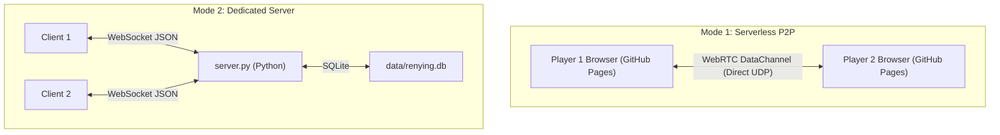

# ⚔ RenYing

<div align="center">


**High-Performance Ink-Wash Martial Arts Action Duel Game**  
*Created by Even, Luffy, and Opus 5.5. Fluid real-time martial arts fighting game powered by HTML5 Canvas, serverless WebRTC P2P multiplayer, and lightweight Python WebSocket networking.*

[](https://amfi-disable.github.io/RenYing/)
[](https://python.org)
[](https://html.spec.whatwg.org)
[](#architecture-and-technical-anatomy)
[](https://github.com/AMFI-Disable/RenYing/releases)
[](license)
[](#privacy-and-security-first)
[](#overview-and-core-value)

</div>

---

## 🌐 Select Language / 选择语言

**[English](readme.md)** •
**[简体中文](readme.zh-cn.md)**

---

## 🧭 Table Of Contents

- [Overview And Core Value](#overview-and-core-value)
- [Key Features](#key-features)
- [Game Controls And Mechanics](#game-controls-and-mechanics)
- [How To Play And Multiplayer Modes](#how-to-play-and-multiplayer-modes)
- [Architecture And Technical Anatomy](#architecture-and-technical-anatomy)
- [Project Structure And Building](#project-structure-and-building)
- [Privacy And Security First](#privacy-and-security-first)
- [Educational And Fair-Play Disclaimer](#educational-and-fair-play-disclaimer)
- [License And Legal Attribution](#license-and-legal-attribution)

---

## ⚡ Overview And Core Value <a id="overview-and-core-value"></a>

**RenYing (刃影)** is a high-speed ink-wash martial arts action duel game created by **Even, Luffy, and Opus 5.5**. Designed for immediate play in school or at home, it offers both serverless browser-to-browser WebRTC Peer-to-Peer multiplayer on GitHub Pages and a standalone zero-dependency Python WebSocket server for local networks.

---

## 🚀 Key Features <a id="key-features"></a>

- **Instant Online Play on GitHub Pages**: Open in any browser without installation, clone, or server hosting.
- **Serverless WebRTC P2P Multiplayer**: Direct peer-to-peer UDP networking between two players with 4-letter room codes and ultra-low input lag.
- **Ink-Wash Visual Style**: Fluid brushstroke particle trails, hit-stop impacts, and traditional Chinese martial arts aesthetic.
- **Optional Dedicated Python Server**: Zero-dependency `server.py` supporting ladder ranking, match replays, and community hub.
- **Pure Offline Standalone Edition**: Complete client (`renying-offline.html`) with embedded audio for single-player and training mode.

---

## 🎮 Game Controls And Mechanics <a id="game-controls-and-mechanics"></a>

### Default Keyboard And Mouse Controls

| Action | Input |
| :--- | :--- |
| **Move Left / Right** | `A` / `D` |
| **Jump / Double Jump** | `W` or `Space` |
| **Block** | Hold `S` |
| **Attack (5-Hit Combo)** | Left mouse button |
| **Charged Slash** | Hold and release the left mouse button |
| **Ranged Move** | Hold the left mouse button, then right-click (or `R`) |
| **Aerial Escape** | Right-click (or `Left Shift`) |
| **Skill / Ultimate** | `Q` / `E` (ultimate needs a full meter) |
| **Pause / Mute** | `P` / `M` (single-player) |

*(Note: Custom touch controls and virtual joysticks activate automatically on mobile and tablet devices).*

---

## 📦 How To Play And Multiplayer Modes <a id="how-to-play-and-multiplayer-modes"></a>

### Option 1: Instant WebRTC P2P (Recommended For School - $0 Budget)

No software installation or Python server required:

1. Both players visit **[https://amfi-disable.github.io/RenYing/](https://amfi-disable.github.io/RenYing/)** on their devices.
2. Player 1 navigates to **联机对战** $\rightarrow$ clicks **建房** $\rightarrow$ shares the generated 4-character room code (e.g., `K7PQ`).
3. Player 2 enters the code into the **加入** box $\rightarrow$ clicks **加入**.
4. Both browsers connect directly via WebRTC DataChannels; PeerJS is only used to find each other.

Some strict networks (certain campus Wi-Fi or firewalls) block direct peer-to-peer traffic. If joining times out, switch networks or use Option 2.

### Option 2: Local Dedicated Server (LAN Mode)

Run the server from the repository root. It serves the game (`index.html`), music, and assets, and adds quick match, ranked ladder, accounts, and reconnect:

```bash
# Start server on default port 8765
python3 server.py

# Or specify a custom port
python3 server.py 9000
```

Open `http://localhost:8765` in your browser. Classmates on the same Wi-Fi can connect directly via `http://<your-lan-ip>:8765`. If your server has an `https://` address (for example through a tunnel), players on GitHub Pages can also enter it under **使用联机服务器（可选）**; browsers block plain `http://` servers from HTTPS pages.

### Option 3: Standalone Offline Play

Double-click or open `renying-offline.html` directly in any web browser without running a server or requiring an active internet connection. Music and the Qingfengxing mini-game are bundled into this single file.

---

## 🏗 Architecture And Technical Anatomy <a id="architecture-and-technical-anatomy"></a>



- **Client Runtime**: Pure vanilla JavaScript utilizing HTML5 Canvas 2D context for ultra-low rendering latency.
- **Rollback Netcode**: Both sides simulate the match deterministically and exchange only inputs; late inputs are corrected by rewinding and re-simulating, with periodic state checksums.
- **P2P Networking**: WebRTC DataChannels with PeerJS handshake and Google STUN NAT traversal (`src/net-p2p.js`).
- **Server Networking**: Raw WebSocket implementation with RFC 6455 framing and keep-alive ping cycles.
- **Persistence**: Local storage and optional SQLite 3 database (`data/renying.db`) storing user accounts with PBKDF2/SHA-256 salted hashes.

---

## 🧱 Project Structure And Building <a id="project-structure-and-building"></a>

Edit the sources, never the generated pages:

| Path | Purpose |
| :--- | :--- |
| `src/page.html` | Page markup with build markers |
| `src/style.css` | All styles |
| `src/game.js` | Game engine, menus, rollback netcode, and server networking |
| `src/net-p2p.js` | Serverless WebRTC direct connection |
| `assets/music/` | Background music (`.mp3`) |
| `assets/qingfengxing.html` | Qingfengxing mini-game |
| `tools/build.py` | Generates the pages below (Python standard library only) |
| `index.html` | Generated online edition (GitHub Pages and `server.py`) |
| `renying-offline.html` | Generated single-file offline edition |
| `renying.html` | Generated redirect for the old address |

After changing anything in `src/` or `assets/`, rebuild and commit the generated pages together with the sources:

```bash
python3 tools/build.py
```

CI runs `python3 tools/build.py --check` and fails if the generated pages are out of date.

---

## 🛡 Privacy And Security First <a id="privacy-and-security-first"></a>

- **Zero Telemetry**: No third-party analytics, external trackers, or diagnostic telemetry.
- **Peer-to-Peer Privacy**: In WebRTC P2P mode, game inputs travel directly between player browsers without passing through any server.
- **Local-First Data**: All matchmaking history, ladder statistics, and replay files remain strictly on your host machine.

---

## ⚖ Educational And Fair-Play Disclaimer <a id="educational-and-fair-play-disclaimer"></a>

> [!CAUTION]
> **IMPORTANT NOTICE & DISCLAIMER**:
> This codebase is provided strictly for educational, research, and non-commercial gaming entertainment purposes.
> Please respect community guidelines and maintain fair-play conduct during multiplayer matchmaking and community chat interactions.
> The developers and contributors accept no responsibility or liability for third-party hosting or server operations.

---

## 📄 License And Legal Attribution <a id="license-and-legal-attribution"></a>

Created by **Even, Luffy, and Opus 5.5**. Licensed under the [MIT License](license). Copyright (c) 2026 AMFI-Disable, Even, Luffy, and Opus 5.5.
