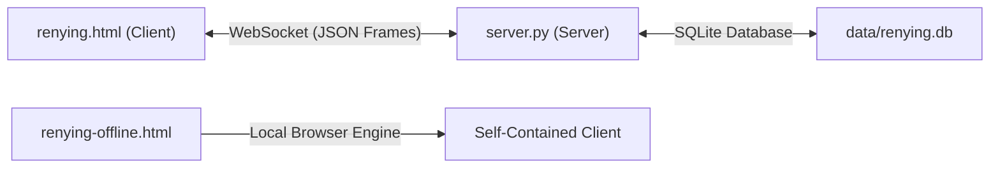

# ⚔ RenYing

<div align="center">


**High-Performance Ink-Wash Martial Arts Action Duel Game**  
*Fluid real-time martial arts fighting game powered by HTML5 Canvas and lightweight Python WebSocket networking.*

[](https://python.org)
[](https://html.spec.whatwg.org)
[](#-architecture-and-technical-anatomy)
[](https://github.com/luffyxing55/Luffx/releases)
[](license)
[](#-privacy-and-security-first)
[](#-overview-and-core-value)

</div>

---

## 🌐 Select Language / 选择语言

**[English](readme.md)** •
**[简体中文](readme.zh-cn.md)**

---

## 🧭 Table Of Contents

- [Overview And Core Value](#-overview-and-core-value)
- [Key Features](#-key-features)
- [Game Controls And Mechanics](#-game-controls-and-mechanics)
- [Quick Start And Running The Server](#-quick-start-and-running-the-server)
- [Architecture And Technical Anatomy](#-architecture-and-technical-anatomy)
- [Privacy And Security First](#-privacy-and-security-first)
- [Educational And Fair-Play Disclaimer](#-educational-and-fair-play-disclaimer)
- [License And Legal Attribution](#-license-and-legal-attribution)

---

## ⚡ Overview And Core Value

**RenYing (刃影)** is a high-speed ink-wash martial arts action duel game. Engineered with standard HTML5 Canvas graphics and a zero-external-dependency Python WebSocket server, it delivers instantaneous combat responses, expressive martial arts animation, and seamless online and offline gameplay.

---

## 🚀 Key Features

- **Ink-Wash Visual Style**: Fluid brushstroke effects, dynamic particle trails, and responsive hit-pause visual feedback.
- **Real-Time Multiplayer Combat**: Room code matchmaking, quick matchmaking queue, and competitive ladder divisions.
- **Zero-Dependency Server**: Standalone Python 3 WebSocket and HTTP server using standard libraries only.
- **Offline Standalone Client**: Complete offline edition (`renying-offline.html`) with embedded audio and character roster.
- **Reconnection Resilience**: Graceful 60-second connection recovery preserves active duel rooms during temporary disconnects.
- **Integrated Community & Hub**: In-game player chat, combat replays, character encyclopedia, and custom skins.

---

## 🎮 Game Controls And Mechanics

### Default Keyboard Controls

| Action | Player 1 (Left) | Player 2 (Local / Numpad) |
| :--- | :--- | :--- |
| **Move Left / Right** | `A` / `D` | `Left Arrow` / `Right Arrow` |
| **Jump** | `W` | `Up Arrow` |
| **Crouch / Drop** | `S` | `Down Arrow` |
| **Light Attack** | `J` | `Numpad 1` |
| **Heavy Attack** | `K` | `Numpad 2` |
| **Dash / Dodge** | `L` | `Numpad 3` |
| **Special / Burst** | `U` / `I` | `Numpad 4` / `Numpad 5` |

*(Note: Custom touch controls and virtual joysticks activate automatically on mobile and tablet devices).*

---

## 📦 Quick Start And Running The Server

### 1. Launch Multiplayer Server

Run the bundled Python server directly with standard Python 3 (no third-party packages required):

```bash
# Start server on default port 8765
python3 server.py

# Or specify a custom port
python3 server.py 9000
```

### 2. Connect In Browser

Open your preferred modern web browser and navigate to:

```text
http://localhost:8765
```

For players on the same local network, connect using the host machine's local IP address (displayed in the server launch log).

### 3. Pure Offline Play

Double-click or open `renying-offline.html` directly in any web browser without running a server or requiring an active internet connection.

---

## 🏗 Architecture And Technical Anatomy



- **Client Runtime**: Pure vanilla JavaScript utilizing HTML5 Canvas 2D context for ultra-low rendering latency.
- **Networking Stack**: Raw WebSocket implementation with RFC 6455 framing and keep-alive ping cycles.
- **Persistence**: SQLite 3 database (`data/renying.db`) storing user accounts with PBKDF2/SHA-256 salted hashes, match replays, and ranking ladders.

---

## 🛡 Privacy And Security First

- **Zero Telemetry**: No third-party analytics, external trackers, or diagnostic telemetry.
- **Local-First Data**: All matchmaking history, ladder statistics, and replay files remain strictly on your host machine.
- **Salted Cryptography**: User passwords never persist in plain text; all credentials use cryptographically secure salted hashes.

---

## ⚖ Educational And Fair-Play Disclaimer

> [!CAUTION]
> **IMPORTANT NOTICE & DISCLAIMER**:
> This codebase is provided strictly for educational, research, and non-commercial gaming entertainment purposes.
> Please respect community guidelines and maintain fair-play conduct during multiplayer matchmaking and community chat interactions.
> The developers and contributors accept no responsibility or liability for third-party hosting or server operations.

---

## 📄 License And Legal Attribution

Licensed under the [MIT License](license). Copyright (c) 2026 AMFI-Disable.
