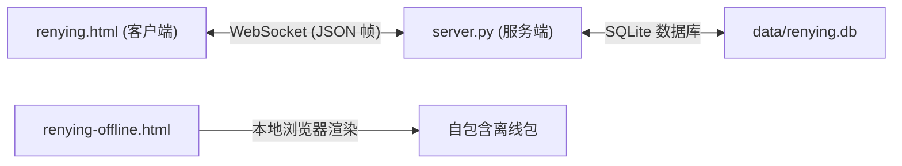

# ⚔ 刃影 (RenYing)

<div align="center">


**高性能水墨风武侠格斗对战游戏**  
*基于 HTML5 Canvas 与零依赖轻量 Python WebSocket 服务器的实时武侠动作游戏。*

[](https://python.org)
[](https://html.spec.whatwg.org)
[](#architecture-and-technical-anatomy)
[](https://github.com/luffyxing55/Luffx/releases)
[](license)
[](#privacy-and-security-first)
[](#overview-and-core-value)

</div>

---

## 🌐 Select Language / 选择语言

**[English](readme.md)** •
**[简体中文](readme.zh-cn.md)**

---

## 🧭 Table Of Contents

- [Overview And Core Value](#overview-and-core-value)
- [Key Features](#key-features)
- [Game Controls And Mechanics](#game-controls-and-mechanics)
- [Quick Start And Running The Server](#quick-start-and-running-the-server)
- [Architecture And Technical Anatomy](#architecture-and-technical-anatomy)
- [Privacy And Security First](#privacy-and-security-first)
- [Educational And Fair-Play Disclaimer](#educational-and-fair-play-disclaimer)
- [License And Legal Attribution](#license-and-legal-attribution)

---

## ⚡ Overview And Core Value <a id="overview-and-core-value"></a>

**刃影 (RenYing)** 是一款快节奏水墨风格的武侠格斗对战游戏。游戏采用纯原生 HTML5 Canvas 渲染与零外部依赖的 Python WebSocket 服务端架构，带来极速打击响应、写意水墨招式与无缝联机体验。

---

## 🚀 Key Features <a id="key-features"></a>

- **写意水墨美术风格**：流畅的笔墨拖尾粒子、顿挫有力的打击定格、纯正武侠意境。
- **实时多人联机对战**：支持 4 位房间码开房邀请、快速匹配与六段位排位天梯（砺锋、出鞘、破竹、惊鸿、踏月、刃影）。
- **零依赖单文件服务器**：仅使用 Python 3 标准库构建的高性能 WebSocket 与 HTTP 联机服务器。
- **纯本地离线单机版**：提供离线单文件版（`renying-offline.html`），音频全内置，随时随地即开即玩。
- **断线保护与重连机制**：对战及选人掉线时保留房间 60 秒，重连即可继续对决。
- **成长系统与内置社区**：集成墨锭货币、问剑阁抽卡、碎片合成、任务系统、战斗回放与社区聊天。

---

## 🎮 Game Controls And Mechanics <a id="game-controls-and-mechanics"></a>

### 默认键盘按键映射

| 操作说明 | 玩家 1 (默认) | 玩家 2 (本地双人小键盘) |
| :--- | :--- | :--- |
| **左右移动** | `A` / `D` | `左方向键` / `右方向键` |
| **跳跃** | `W` | `上方向键` |
| **蹲伏 / 下落** | `S` | `下方向键` |
| **轻击** | `J` | `数字小键盘 1` |
| **重击** | `K` | `数字小键盘 2` |
| **闪避 / 疾冲** | `L` | `数字小键盘 3` |
| **绝技 / 爆气** | `U` / `I` | `数字小键盘 4` / `数字小键盘 5` |

*(注：在移动设备或平板触控屏上，游戏将自动启用虚拟摇杆与触控按键)。*

---

## 📦 Quick Start And Running The Server <a id="quick-start-and-running-the-server"></a>

### 1. 启动联机服务器

直接使用系统自带的 Python 3 运行服务端程序（无需额外安装任何第三方依赖库）：

```bash
# 启动默认 8765 端口服务
python3 server.py

# 或指定自定义端口
python3 server.py 9000
```

### 2. 浏览器打开游戏

在现代浏览器中直接访问：

```text
http://localhost:8765
```

局域网联机时，好友可通过控制台输出的局域网 IP 地址访问加入房间。

### 3. 单机离线游玩

无需运行服务器，直接使用浏览器双击打开 `renying-offline.html` 即可畅玩单机及双人本地模式。

---

## 🏗 Architecture And Technical Anatomy <a id="architecture-and-technical-anatomy"></a>



- **客户端架构**：纯原生 JavaScript 与 HTML5 Canvas 2D，确保极致流畅的渲染与低输入延迟。
- **网络通信**：标准 RFC 6455 帧解析与心跳检测，毫秒级状态同步。
- **数据持久化**：SQLite 3 数据库（`data/renying.db`），密码加盐哈希存储，确保数据安全。

---

## 🛡 Privacy And Security First <a id="privacy-and-security-first"></a>

- **零数据追踪**：无任何第三方统计脚本或分析 SDK，纯净无广告。
- **本地优先运行**：所有战绩数据、天梯积分与本地回放均保存在本地设备。
- **密码安全加盐**：所有账户密码均经过加盐哈希处理，杜绝明文风险。

---

## ⚖ Educational And Fair-Play Disclaimer <a id="educational-and-fair-play-disclaimer"></a>

> [!CAUTION]
> **免责声明与公平竞技声明**：
> 本项目源码与资源仅供学习研究、技术交流与个人非商业娱乐使用。
> 请遵守相关社区规范，在联机对战与社区交流中保持友善文明与公平竞技。
> 开发者对第三方独立搭建之服务器及衍生内容不承担法律责任。

---

## 📄 License And Legal Attribution <a id="license-and-legal-attribution"></a>

本项目采用 [MIT License](license) 开源协议。Copyright (c) 2026 AMFI-Disable.
