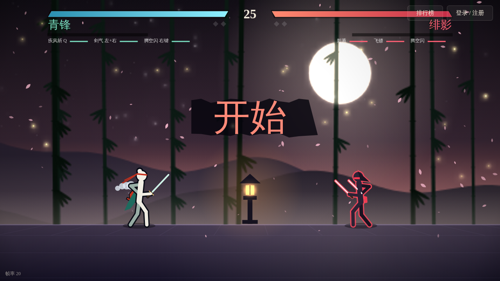
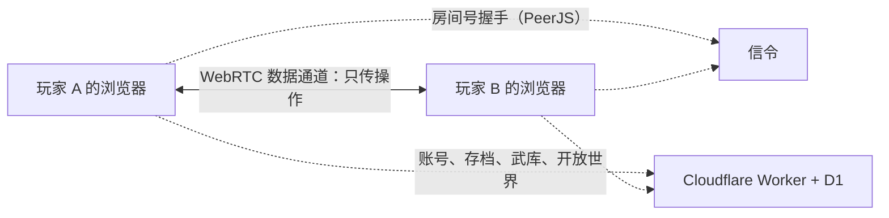

# ⚔ 刃影

<div align="center">



**在浏览器里打开就能玩的水墨武侠格斗游戏。**  
*由 Even、Luffy、Opus 5.5 和 Gemini 4 Argon 制作。纯 JavaScript 画在一块 canvas 上，点对点联机，账号和存档用可选的 Cloudflare Worker。*

[](https://amfi-disable.github.io/RenYing/)
[](docs/history/changelog.md)
[](#侠客)
[](#工作原理)
[](#工作原理)
[](license)

**[English](readme.md)** • **[简体中文](readme.zh-cn.md)** • **[Wiki](https://github.com/AMFI-Disable/RenYing/wiki)**

</div>

---

## 目录

- [这是什么](#这是什么)
- [怎么玩](#怎么玩)
- [操作](#操作)
- [模式](#模式)
- [侠客](#侠客)
- [武库](#武库)
- [工作原理](#工作原理)
- [仓库结构](#仓库结构)
- [构建与测试](#构建与测试)
- [参与开发](#参与开发)
- [隐私](#隐私)
- [许可](#许可)

---

## 这是什么

**刃影（RenYing）** 是一款节奏很快的水墨风 2D 格斗游戏。十六位侠客各有自己的攻击距离、体量、被动和三个招式，可以一对一、2v2 组队，或者 3v3 车轮战。画面上的一切，从笔触拖尾到围巾飘动、受击闪光，都是代码在一块 canvas 上实时画出来的，没有贴图序列帧。

它是为了和同学朋友马上开打而做的：打开链接，把四位房间号发给对方，两个浏览器就直接连上。另有一个单文件离线版，完全不用网络。

游戏支持简体中文和英文，随时可以在顶栏或设置里切换。

---

## 怎么玩

| 方式 | 做法 |
| :--- | :--- |
| **在线** | 用 Chrome、Edge、Safari 或 Firefox 打开 <https://amfi-disable.github.io/RenYing/>，什么都不用装。 |
| **离线** | 下载 `renying-offline.html`，双击打开。音乐和青锋行小游戏都在这一个文件里。离线版没有联机模式和账号。 |
| **手机或平板** | 打开同一个链接，把设备横过来，触屏操作会自动出现。 |

### 和朋友联机

1. 两个人都打开游戏。
2. 一个人进 **联机**，建好友房间，把房间号（例如 `K7PQ`）发给对方。
3. 另一个人输入房间号加入。

之后操作直接从一个浏览器发到另一个浏览器。有些网络（部分校园网、公司网）会拦点对点连接，这时游戏会向服务器要一条中转线路，照样能连上。

---

## 操作

1P 默认的键盘和鼠标操作。每个键都可以在 **设置** 里改。

| 动作 | 鼠标 | 键盘 |
| :--- | :--- | :--- |
| 移动 | | `A` / `D` |
| 跳、二段跳 | | `W` 或 `空格` |
| 防御（按住）、从平台跳下（`↓` + 跳） | | `S` |
| 普攻，五连段 | 左键 | `X` |
| 蓄力斩 | 按住左键再松开 | 按住 `X` 再松开 |
| 技能一 | | `Q` |
| 技能二 | 按住左键再点右键 | `R` |
| 大招（气满才能放） | | `E` |
| 腾空闪 | 右键 | `左 Shift` |
| 暂停 / 静音 | | `P` / `M` |

- **纯键盘：** 所有菜单、对话框、点将台和结算页都能用方向键或 WASD 移动，`Enter`/`空格` 确认，`Esc` 返回，金色框表示当前选中。
- **一台电脑多人：** 2P 到 4P 各有一组键（方向键 + `UIOJK`、`TFGH` + `CVBNM`、小键盘）。
- **触屏：** 左边虚拟摇杆，右边动作按钮。

---

## 模式

| 模式 | 玩什么 |
| :--- | :--- |
| **演武** | 和电脑单挑，六档难度从 入门 到 天道，可以选场地和规则。 |
| **天机乱斗** | 每 15 秒场上来一种随机异变。 |
| **通天神决** | 全员 10 倍真元、技能零冷却、招式威力翻倍。 |
| **山河异境** | 六张带平台、冰面、大风和雷击的地图，投票选图。 |
| **3v3 车轮战** | 每边三位侠客，蛇形选人；赢下回合的一方带着剩余血量继续。 |
| **2v2** | 两人对两个电脑，或两人对两人，本机或联机都行。 |
| **守关挑战** | 一章一章闯关，按星级给奖励。 |
| **侠客列传** | 每位侠客一部有分支选择、两个结局的故事。 |
| **问剑密卷** | 爬塔，一路攒秘卷组成这一局的打法。 |
| **同袍肉鸽** | 2 到 3 人共享秘卷和回血，一起打融魂魔首。 |
| **江湖共斗 · 开放世界** | 全服共用一张 24000 像素宽、八个区域的大地图，有世界 Boss 和全服共同推进的江湖长卷，每条线最多 40 人。 |
| **天魔讨伐** | 全服一起打的 Boss 战。 |
| **联机** | 快速匹配、排位赛、好友房间，还有 2v2、魔首和各种特殊规则。 |
| **木人桩** | 对着木人自由练连招。 |
| **观战与回放** | 看电脑之间的对局，保存和导入回放。 |
| **青锋行** | 独立的 3D 动作小游戏，可单人，也可 2 到 4 人联机。 |

排位赛、开放世界、天魔讨伐和武库的玩家市场要连服务器并登录账号，其余模式游客也能玩。

---

## 侠客

一共十六位。每位都有一个被动，`Q` 一个技能，`R` 第二个技能，`E` 大招。

| 侠客 | 定位 | Q | R | E |
| :--- | :--- | :--- | :--- | :--- |
| 青锋 | 游龙剑客 | 疾风斩 | 剑气 | 残月 |
| 绯影 | 暗影刺客 | 影遁 | 飞镖 | 千影 |
| 铁山 | 玄铁重甲 | 震地 | 铁壁冲 | 山崩 |
| 凌霜 | 寒枪骁将 | 回马枪 | 枪旋 | 刹那 |
| 流云 | 御风散人 | 风刃 | 开扇 | 龙卷 |
| 雷鸣 | 雷拳武僧 | 雷闪 | 金刚雷铠 | 雷霆万钧 |
| 墨羽 | 泼墨画师 | 墨阵 | 画符 | 符阵 |
| 月华 | 月镜宗师 | 月镜 | 月轮 | 月华如水 |
| 燕翎 | 御空飞燕 | 俯冲 | 翎羽 | 万羽 |
| 玉箫 | 箫音乐师 | 清音 | 回音壁 | 广陵散 |
| 醉翁 | 山水醉翁 | 亭中留客 | 与民同乐 | 山水之间 |
| 勾陈 | 链锤游侠 | 飞锤 | 旋锤 | 开天一锤 |
| 凌雀 | 飞梭游侠 | 穿叶飞梭 | 移形换影 | 万线归宗 |
| 离影 | 离魂刀客 | 留影 | 渡影 | 万影归一 |
| 磁仙 | 两极方士 | 极性反转 | 磁极 | 天地磁合 |
| 千机 | 机关傀客 | 金丝回环 | 穿丝急袭 | 机轮三穿 |

完整招式和帧数见 [Wiki：侠客与战斗](https://github.com/AMFI-Disable/RenYing/wiki/Heroes-and-Combat) 和 [docs/ai/frame-data.md](docs/ai/frame-data.md)。

---

## 武库

武库是游戏里的外观收藏。皮肤和武器外观不改变侠客的任何数值。

- **墨锭** 是唯一的货币，靠玩游戏获得（每日每周任务、关卡、列传）。没有任何真钱商店。
- **武器箱** 各装一套皮肤，分五档品质；每种箱子每天或每周能开的数量有限。
- **斩数版** 会记录这件皮肤打出的击倒数。
- **熔铸契** 把同一档的十件换成高一档的一件。
- **玩家市场** 玩家之间用墨锭买卖，每笔成交扣一点手续费，免得墨锭越攒越多。
- **货郎** 一次报一件、按固定价格卖。

云端账号的每一次武库操作都由服务器核对并记录。详见 [Wiki：武库与市场](https://github.com/AMFI-Disable/RenYing/wiki/Armory-and-Marketplace)。

---

## 工作原理



- **客户端：** 原生 JavaScript 画在一块 HTML5 canvas 上。没有框架、没有打包器、运行时不依赖任何 npm 包。游戏逻辑固定每秒 120 步。
- **回滚联机：** 两个浏览器用同一个随机种子各自算整局，只互相发操作。某一帧的操作来晚了，就退回存好的那一帧，用正确的操作重算再追上来；双方还定期对一次状态校验和，发现不同步。
- **连接：** WebRTC 数据通道，PeerJS 负责握手，公共 STUN 服务器打洞；直连不通时 Worker 可以发短时有效的 TURN 中转凭据。
- **服务器（可选）：** Cloudflare Worker 加 D1 数据库，负责账号、云存档、武库经济、排行榜和开放世界（每条线一个 Durable Object）。没有它游戏也能玩。
- **生成的网页：** `tools/build.py` 把 `src/` 里的源码拼成 `index.html`（在线版）和 `renying-offline.html`（单文件离线版）。

更多见 Wiki：[联机与回滚同步](https://github.com/AMFI-Disable/RenYing/wiki/Multiplayer-and-Netcode)、[架构与开发](https://github.com/AMFI-Disable/RenYing/wiki/Architecture-and-Development)。

---

## 仓库结构

| 路径 | 是什么 |
| :--- | :--- |
| `src/page.html`、`src/style.css`、`src/styles/` | 页面结构（带构建标记）和按文件名顺序拼接的样式 |
| `src/game/` | 游戏本体，按编号拆成多个文件，`tools/build.py` 按顺序拼起来 |
| `src/data/` | 数据表：`src/data/heroes/` 一位侠客一个文件，还有模式、点将台顺序、地图、电脑难度、界面英文。构建时由 `tools/checks/data-check.mjs` 检查 |
| `src/ai.js` | 电脑对手 |
| `src/net-p2p.js` | 点对点连接 |
| `src/cloud.js` | 账号和云存档 |
| `src/armory-core.js`、`src/armory.js` | 武库规则和武库界面 |
| `src/anticheat.js` | 客户端完整性检查 |
| `src/social.js`、`src/errlog.js`、`src/i18n.js` | 社区功能、错误上报、翻译查表 |
| `src/qfx/` | 青锋行小游戏的源码 |
| `assets/` | 音乐、生成的小游戏页面、内置的 `peerjs` 和 `three.js` |
| `cloudflare/` | 按编号拆分的 Worker 源码、生成的 Worker 入口、管理后台页面、D1 表结构和迁移 |
| `src/models/` | 训练好的电脑 AI 权重 |
| `tools/` | `build.py`，以及 `ai/`、`admin/`、`audits/`、`checks/`、`tests/` 和 `music/` |
| `docs/` | 按主题分：`ai/`（AI 设计、帧数表、平衡报告）、`bugs/`、`design/`、`ops/`（部署手册、管理后台说明）、`project/`、`history/`（更新日志、版本历史），以及 `wiki/`（Wiki 源文件） |
| `.github/` | CI 流程、issue 和 PR 模板、`contributing.md` |
| `index.html`、`renying-offline.html` | **生成的文件。** 在线版和离线版 |
| `renying.html` | 旧地址的提示页 |

---

## 构建与测试

需要 Python 3.10 以上和 Node 22，不需要 `npm install`。

只改 `src/`、`assets/` 或 `cloudflare/` 里的文件，不要手改生成的网页。改完重新生成：

```bash
python3 tools/build.py
```

提交前确认生成的网页是最新的：

```bash
python3 tools/build.py --check
```

主要测试（CI 里都会跑）：

| 测什么 | 命令 |
| :--- | :--- |
| 战斗、每位侠客、2v2 电脑 | `node tools/tests/combat-test.mjs --sim` |
| 回滚确定性 | `node tools/tests/rollback-test.mjs --rollback` |
| 两份游戏隔着卡顿网络对打 | `node tools/tests/netplay-test.mjs` |
| 武库经济和数据库迁移 | `node tools/tests/econ-test.mjs` |
| 云存档客户端 | `node tools/tests/cloud-test.mjs` |
| 多设备同步 | `node tools/tests/sync-test.mjs` |
| 开放世界服务器 | `node tools/tests/world-test.mjs` |
| 反作弊检查 | `node tools/tests/anticheat-test.mjs` |

浏览器检查要先开本地服务器（`python3 -m http.server 8791`），然后比如 `node tools/audits/ui-audit.mjs ci-ui 1440 900`、`node tools/audits/hud-audit.mjs ci-hud 1440 900`、`node tools/audits/touch-audit.mjs ci-touch`、`node tools/audits/kb-flow-test.mjs ci-kb 1440 900`。`node tools/tests/test.mjs` 一次跑完主要的几项。

完整的测试清单见 Wiki 的 [测试与 CI](https://github.com/AMFI-Disable/RenYing/wiki/Testing-and-CI)。Worker 由维护者部署，步骤在 [docs/ops/deploy-runbook.md](docs/ops/deploy-runbook.md)。

---

## 参与开发

先看 [contributing.md](.github/contributing.md)。简单说：

- 提交信息写成 `类型: 三个小写英文单词`（例如 `fix: guard break timing`），别的写法 CI 不通过。
- 仓库里所有文件名都是小写。
- Markdown 标题用 Title Case（英文每个实词首字母大写）。
- 改了源码要重新生成网页，和源码一起提交。
- 只合并维护者和仓库协作者开的 PR。

问题和想法提到 [Issues](https://github.com/AMFI-Disable/RenYing/issues)。安全问题请按 [security.md](security.md) 私下报告，不要公开发 issue。

---

## 隐私

- 没有广告、没有跟踪脚本、没有第三方统计。
- 在线版有一份自己的匿名游玩统计：打开网页、新手教学、开了哪个模式的一局。只带一个本机随机编号（服务器再加盐哈希才存），不带名字、账号、邮箱、IP，用来看每天多少人玩、新玩家回不回来。设置里「匿名统计」可以关，离线版没有。
- 游客和离线版的数据都只存在浏览器本地。
- 云端账号会把存档、武库和对局记录存在游戏的 Worker 上。密码用加盐的 PBKDF2 存哈希，登录令牌也只存哈希。
- 在线版会把崩溃报告（没接住的错误）和少量可疑伤害记录发给 Worker，方便修 bug，里面没有密码。
- 点对点对局时，你的操作直接发到对方浏览器。

> [!NOTE]
> 刃影是非商业项目，用来学习和跟朋友一起玩。对局和聊天请友善。

---

## 许可

[MIT](license)。Copyright (c) 2026 AMFI-Disable, Even, Luffy, Opus 5.5, and Gemini 4 Argon.
