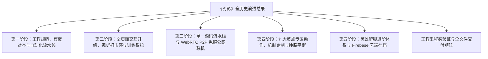
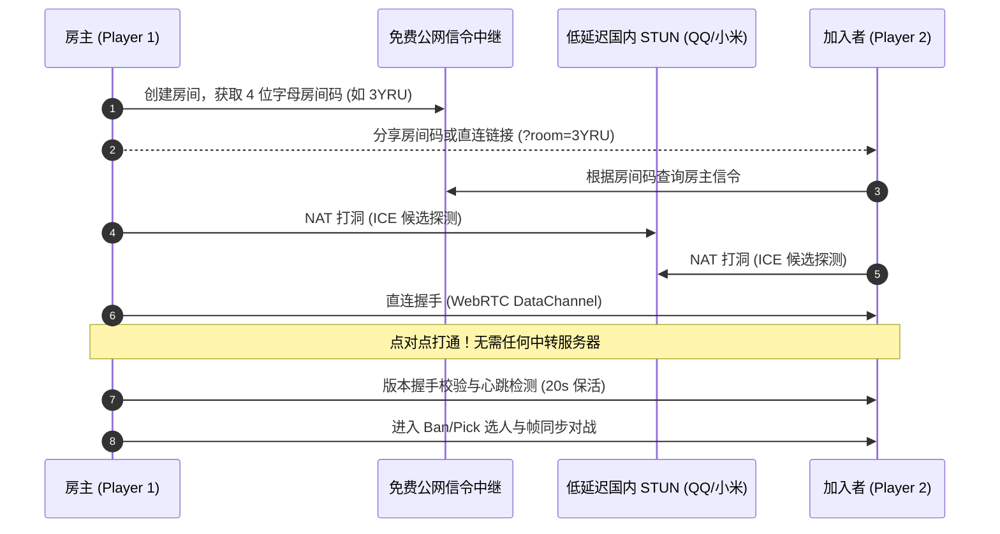
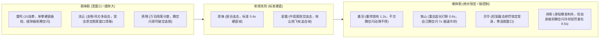

# 《刃影》(RenYing) 全历史演练与工程演进总录
# (RenYing Complete Master Walkthrough & Engineering Chronicle)

本演练文档汇编并整合了历次开发会话中关于《刃影》（RenYing）的**全部演练记录（Walkthroughs）**。内容严格限定于《刃影》本身，涵盖从项目立项与工程规范初始化、核心战斗与页面深度优化、纯前端 WebRTC P2P 免服务器公网联机体系，到九大英雄专属骨骼动作、纯机制克制逻辑及挣脱平衡体系的完整演进全貌。

---

## 🎯 目录导航



---

## 🏛️ 第一阶段：工程规范、模板对齐与自动化流水线
*(来源归档：`c5d34a36-69ad-4056-b9bd-8cc554f9ee70/walkthrough.md`)*

在工程初始化与仓库合规性审计中，《刃影》仓库（[`RenYing`](file:///Users/even/Desktop/Projects/Games/RenYing)）按照标准化规范完成了代码与文档全方位整顿：

### 1. 文档锚点与 Markdownlint 格式治理
- **片段锚点对齐 (MD051)**：
  - 修复了所有 section 标题的 markdownlint 锚点解析异常，在 [`readme.md`](file:///Users/even/Desktop/Projects/Games/RenYing/readme.md) 与 [`readme.zh-cn.md`](file:///Users/even/Desktop/Projects/Games/RenYing/readme.zh-cn.md) 中统一植入显式 HTML 锚点 `<a id="..."></a>`。
  - 标准化目录链接与徽章跳转路径，实现 `npx markdownlint-cli *.md .github/**/*.md` **0 错误、0 警告**。

### 2. 仓库瘦身与大文件剥离
- 安全剥离了根目录下未跟踪的历史备份包 `renying-v4.5.zip`（5.3 MB），确保 Git 工作树轻量纯净，杜绝大体积二进制资产被误提交进历史对象库。

### 3. GitHub Issue & PR 标准化模板
- 在 `.github/issue_template/` 下创建并规范化：
  - [`bug_report.md`](file:///Users/even/Desktop/Projects/Games/RenYing/.github/issue_template/bug_report.md)：包含浏览器环境、联机模式（P2P/WebSocket）、控制方式（键盘/触摸）及帧率诊断字段。
  - [`feature_request.md`](file:///Users/even/Desktop/Projects/Games/RenYing/.github/issue_template/feature_request.md)：包含功能价值阐述、替代方案分析与设计预案。

### 4. 严苛的 GitHub Actions CI 持续集成构建
- 创建流水线 [`.github/workflows/ci.yml`](file:///Users/even/Desktop/Projects/Games/RenYing/.github/workflows/ci.yml)，集成六重自动化质量卡点：
  1. **Python 3.12 语法编译**：`python3 -m py_compile server.py tools/build.py`。
  2. **Ruby YAML 严谨校验**：遍历并安全解析所有 `.github/**/*.{yml,yaml}` 配置。
  3. **全小写路径检查**：`git ls-files | grep '[A-Z]'` 严格阻断大小写混淆文件。
  4. **游戏核心入口校验**：确保 `index.html`、`renying.html`、`renying-offline.html` 实体存在。
  5. **生成页面零漂移检查**：执行 `python3 tools/build.py --check`，确保单文件构建与源码强一致。
  6. **提交信息规范拦截**：严格正则匹配 `^[a-z]+: [a-z0-9]+ [a-z0-9]+ [a-z0-9]+$`。

---

## ⚔️ 第二阶段：全页面交互升级、视听打击感与训练系统
*(来源归档：`431ce09c-1f20-4368-a8fb-b0bbef6a157c/walkthrough.md`)*

对游戏的视听冲击力、各子页面交互以及训练反馈机制进行了全链路重构打磨：

### 1. 战斗系统与视听打击感 (Combat Feel & Visual Juice)
- **破招机制（Counter Hit）与水墨行楷大字**：
  - 在对手出招前摇（startup）期间命中判定为破招，伤害提升 20%（`dmg *= 1.2`）。
  - 触发赤红屏幕闪烁（`flashRGB = '255,60,50'`）、重度顿帧（`hitstop = 0.18s`）与屏幕震颤（`shake = 14`）。
  - 受击点浮现行楷书法大字 **「破」**（`TITLE_FONT`，毛笔外发光与缩放弹出粒子效果）。
- **招架反击（Parry）视觉强化**：
  - 招架成功即时弹出金琥珀色书法大字 **「截」**，伴随清脆金石交击回响与光环扩散。
- **满气奥义视觉反馈**：
  - 角色满气（`meter >= 100`）时，世界坐标中角色周身持续升腾刀芒色灵气火花。
  - HUD 气槽边缘呈现动态律动鎏金流光边框，并在技能名称前添加醒目就绪闪烁指示（`⚡ 绝技就绪`）。
- **木人桩试剑数据卡片重构**：
  - 采用水墨半透明卡片设计（金黄微边 `rgba(233,196,106,0.35)`）。
  - 实时高亮显示木人状态、本次连击数与伤害、历史最高伤害、总伤害与实时秒伤（DPS，高亮冰蓝显示），附带 `1/2/3/4` 快捷切换提示。

### 2. 设置页面：1P 按键完全自定义 (Settings: Key Rebinding)
- **自定义键位映射面板**：
  - 新增 **1P 键位设置** 独立卡片，网格化展示各动作绑定键位（左移、右移、跳跃、下蹲、冲刺、绝技、门派绝学、特殊技）。
  - 点击对应按键后显示“请按按键...”，按下任意键盘按键即时录入并生效，按 `ESC` 键可取消录入。
  - 支持 **一键恢复默认**，键位配置持久化保存在浏览器 `localStorage('renying-1p-keys')` 中。
  - HUD 招式快捷键提示根据玩家当前配置的自定义按键动态刷新。

### 3. 角色图鉴：招式点击即时演示 (Codex: Click-to-Demo)
- **交互式招式试看**：
  - 图鉴中的每一个招式卡片（连击、蓄力、空中、绝学、特殊技、奥义、腾空闪）赋予 `data-move` 属性与悬停动效。
  - 点击任意招式卡片，卡片获得金光激活边框（`.active-demo`），右上方傀儡演示画布即刻切换播放该招式的专属动作序列与打击火花特效。

### 4. 任务页面：一键领取与快捷前往 (Tasks: Claim All & Quick Jump)
- **一键领取（Claim All）**：
  - 顶部新增 **「一键领取」** 按钮，当存在未领取的已完成任务时点亮，批量结算奖励并播放聚气音效。
- **任务快捷前往（Task-Go）**：
  - 对未达成的任务追加 **「前往」** 按钮，智能识别任务类型并直达目标界面（匹配排位、木人试炼等）。

### 5. 录像回放：导入与导出 (Replays: Export & Import)
- **录像文件导出**：每个历史对局行均提供 **「导出」** 按钮，一键下载为标准的 JSON 文件（`RenYing-Replay-*.json`）。
- **录像文件导入**：顶部新增 **「导入录像」** 按钮，支持载入本地 JSON 录像文件并在游戏中直接还原播放。

---

## 🌐 第三阶段：单一源码流水线与 WebRTC P2P 免服公网联机
*(来源归档：`431ce09c-1f20-4368-a8fb-b0bbef6a157c/walkthrough.md`)*

为了彻底解决“玩家在 GitHub Pages 公网部署环境下无需启动本地 `server.py` 即可随时联机开黑”的核心痛点，实现了完备的 WebRTC P2P 点对点联机架构：



### 1. 资产解耦与页面轻量化
- **背景音乐分离**：将原本嵌入在 HTML 中的大体积音频抽出，独立存放在 [`assets/music/`](file:///Users/even/Desktop/Projects/Games/RenYing/assets/music/)，使得在线版 [`index.html`](file:///Users/even/Desktop/Projects/Games/RenYing/index.html) 从 6.5 MB 骤降至 **1.6 MB**，极大提升了弱网加载速度。
- **PeerJS 本地化集成**：将 [`assets/peerjs.min.js`](file:///Users/even/Desktop/Projects/Games/RenYing/assets/peerjs.min.js) 打包内嵌，消除外部不可靠 CDN 的网络超时与阻断风险。
- **单一源码构建流水线**：由 [`tools/build.py`](file:///Users/even/Desktop/Projects/Games/RenYing/tools/build.py) 统筹生成在线版 [`index.html`](file:///Users/even/Desktop/Projects/Games/RenYing/index.html) 与全内嵌离线单文件 [`renying-offline.html`](file:///Users/even/Desktop/Projects/Games/RenYing/renying-offline.html)。

### 2. 双模联机切换与环境自动探测
- **环境自适应**：访问页面时自动探测宿主环境。在静态托管（`https://amfi-disable.github.io/RenYing/`）下默认激活 **WebRTC 免服务器直连**，杜绝了试图连接 `ws://127.0.0.1:8765` 导致的浏览器 Mixed Content 安全拦截。
- **低延迟 STUN 矩阵**：内置腾讯 QQ、小米、Cloudflare、Google 与 Twilio 多路 STUN 节点，大幅提升国内各运营商网络下的 NAT 穿透成功率。
- **一键分享与 URL 直连**：生成纯字母 4 位友好房间码，支持一键复制房间链接；通过链接带参（`?room=XXXX`）打开即可全自动连接入房。
- **状态机健壮性保障**：实现版本握手校验（版本不一致温和提示）、20 秒心跳静默超时判定、角色协商（房主/加入者隔离）及离开单人模式自动解绑，防止残留事件扰乱对局。

---

## 🥋 第四阶段：九大英雄专属动作、机制克制与挣脱平衡
*(来源归档：`431ce09c-1f20-4368-a8fb-b0bbef6a157c/walkthrough.md`)*

针对九位英雄的手感同质化问题，摒弃简单的数值 Debuff，全面构建基于**专属骨骼动画**、**机制逻辑位移克制**与**受身挣脱博弈谱系**的深度格斗模型：

### 1. 22 个专属骨骼动画姿态与动作差异化
在 `POSES` 中为全部 9 位英雄量身打造定制化关节骨骼参数：

| 英雄 | 定位特质 | Q 技能专属动作姿态 | R 技能专属动作姿态 | 奥义释放与视效动作姿态 |
| :--- | :--- | :--- | :--- | :--- |
| **青锋** | 均衡剑客 / 居合 | `qf_charge` (深纳刀蓄力) -> `qf_thrust` (极速居合冲刺) | `qf_charge` -> `qf_thrust` (沉步拔刀剑气) | 蓄力 `qf_charge`，冲刺 `qf_thrust`，六连剑气乱斩 `l3a`/`hva`，终结 `a2a` 下劈就地重创 |
| **绯影** | 暗杀刺客 / 极速 | `fy_seal` (结印) -> `fy_xslash` (猩红双刃十字绞杀) | `fy_seal` -> `fy_crouch` (散落手里剑) | 蓄力 `fy_seal`，冲刺 `fy_crouch` (贴地暗影瞬步)，九道残影乱斩分身 + 烟雾，终结 `fy_xslash` 暴击 |
| **铁山** | 重甲巨剑 / 霸体 | `ts_lift` (双手托举重刃) -> `ts_slam` (泰山压顶怒砸) | `ts_shoulder` (沉肩铁壁冲撞) | 蓄力 `ts_lift`，起跳擎天，滞空期间全自由操控空中落点（亦可按 S 加速下砸），下砸 `ts_slam` 砸碎地面石块飞溅 |
| **凌霜** | 长枪 / 控场刺击 | `ls_stance` (龙枪回马后撤) -> `ls_thrust` (龙枪破空突刺) | `ls_stance` -> `ls_plant` (长枪旋舞风车护盾) | 蓄力 `ls_stance`，时空冻结挥洒枪影 `ls_thrust`，冲击后长枪驻地 `ls_plant` |
| **流云** | 远程御风 / 三段跳 | `ly_fanswipe` (舒袖展扇御风) -> `idle` | `ly_fanswipe` (风遁移形) | 蓄力 `ly_fanswipe`，释放双重龙卷时切换 `ly_hover` 优雅悬浮控风 |
| **雷鸣** | 迅猛拳师 / 贴身连击 | `lm_boxer` (拳师格斗势) -> `lm_jab` (雷光贴地直拳) | `lm_kick` (撼地重踏破防) | 蓄力 `lm_boxer`，引天雷 `lm_kick` 破空冲天拳，召落三道天雷 |
| **墨羽** | 挥毫泼墨 / 阵地控制 | `my_stroke` (饱蘸浓墨挥毫) -> `my_paint` (绘就墨阵法印) | `my_stroke` -> `my_paint` (写意甩出抛物墨团) | 蓄力 `my_stroke`，泼墨成龙 `my_paint` 巨大墨龙横扫全屏 |
| **月华** | 借力反击 / 优雅回血 | `yh_mirror` (月轮当胸结印护体) -> `hva` (截断绝罚反斩) | `yh_mirror` (掷出月轮回旋双刃) | 蓄力与释放 `yh_lotus` (双月盘坐入定月华盛放)，绽放月晕治愈自身并击飞敌方 |
| **燕翎** | 展翼御空 / 滞空倾泻 | `jump` -> `yl_dive` (猎鹰凌空俯冲突袭) | `yl_wings` (展双翼齐射破空翎羽) | 蓄力与召唤 `yl_wings` (九霄展翅引动万羽倾泻暴雨) |

### 2. 纯机制与逻辑位移的「克制 (Counter)」体系 (No Hero Debuffs)
完全由判定盒、场景交互与技能判定规则产生的原生克制：
1. **滞空天然克制地裂震击 (Air Evasion vs. Ground Quakes)**：
   - 铁山的「震地」、大招「山崩」震波与雷鸣的「撼地」均带有 `groundOnly: true`。
   - 只要目标身处空中或飞行状态（`foe.y < -16 || foe.flying`），地裂震波直接穿透而过，造成 0 判定。燕翎（御空）与流云（三段跳/悬浮）天克地面震地战术。
2. **青锋疾风居合净除墨阵 (Wind Cleansing vs. Ink Traps)**：
   - 墨羽在地面布设的「墨阵」定身陷阱，在青锋发动「疾风斩」居合穿透时会被刀风直接斩碎净化，瓦解墨羽的阵地封锁。
3. **凌霜枪旋弹落飞行道具 (Projectile Deflection)**：
   - 凌霜释放「枪旋」长枪风车期间，迎面而来的常规轻型投掷物（如流云的风刃、绯影的手里剑、燕翎的飞羽、墨羽的墨弹）会被判定格飞并消散。
4. **铁山重甲动能吸收充能 (Armor Kinetic Absorption)**：
   - 铁山处于重斩霸体或「铁壁冲」霸体期间受到多段攻击（如雷鸣的十连拳或绯影的轻连击）时，不仅享有 40% 减伤，还会把受到的冲击动能转化为自身怒气（`+4% 绝技气量`）并缩短技能冷却（`-0.4s`）。强行肉搏打铁山霸体只会让铁山更快放出山崩与铁壁冲。
5. **凌霜枪尖甜区与近身惩罚 (Spacing Sweetspot)**：
   - 枪尖极远端（`距离 >= 155px`）：造成 **+25% 额外暴击伤害** 并强力挑飞滞空。
   - 贴身极近距离（`距离 < 72px`）：长枪柄部伤害骤降至 **38%** 且无挑空判定。
   - 刺客（绯影）与近身拳师（雷鸣）一旦突进贴身便能压制凌霜；而中距离拉扯则会被凌霜枪尖狠狠折磨。
6. **月华月镜格开绝对惩罚锁定 (Parry Punish Lock-in)**：
   - 月华「月镜」成功化解近身招式时，反击绝罚判定强制施加 `foe.breakCD = Math.max(foe.breakCD, 0.4s)`，禁止被反击方直接起按腾空闪受身脱逃，确保高难度格挡收益百分百兑现。
7. **月轮回旋折返破正面防守 (Behind-the-Back Crossup)**：
   - 月华「月轮」飞至最远端后折返穿透敌方身后，若敌方依然面朝前方防御，折返月刃将直击后背造成破防。

### 3. 伤害梯度与“易挣脱 ↔ 难挣脱”平衡体系 (Escape & Damage Spectrum)



| 英雄 | 核心伤害特征 | 挣脱冷却 (escCD) | 对手挣脱难易度及对抗博弈 |
| :--- | :--- | :--- | :--- |
| **雷鸣** | 十连拳（单段 3 伤害，连击衰减仅 0.04，总伤极高） | 8.0s | **极易挣脱**：单拳硬直仅 0.22s，每两拳之间有 0.08s 反应空隙，对手若有腾空闪随时可以脱逃反打；无闪则吃满伤害。 |
| **流云** | 龙卷多段削血（2x8x2 伤害）+ 风刃（7 伤害） | 9.0s | **易挣脱**：龙卷多段击打过程中受击方受身窗口明显；但三段跳滞空不易被地面反击。 |
| **燕翎** | 俯冲（11 伤害，滞空命中即刷新）+ 万羽（2.2x14） | 8.5s | **较易挣脱**：暴雨羽刃落地有范围扩散，对手腾空闪升空即可规避后续飞羽。 |
| **青锋** | 均衡基准（疾风斩 6，剑气 8，残月 29 伤害） | 8.5s | **适中**：经典 2-3 连段与居合破绽，硬直窗口规范。 |
| **凌霜** | 极远枪尖挑空（增伤至 11-15），时空刹那（12-22） | 8.5s | **适中**：枪尖命中挑飞有空中追击空间，但被贴身时伤害大幅缩水。 |
| **铁山** | 单发毁天灭地（蓄力斩 24，山崩 28，地裂 9+6） | **7.0s (全场最短)** | **难挣脱**：攻击带极重顿帧与打断，中一刀难以抢招；且铁山自身被连时 7 秒即可再次腾空闪霸体脱离。 |
| **墨羽** | 墨阵定身（4 伤害 + 1.2s 锁死移动）+ 墨龙（20 伤害穿场） | 9.0s | **极难挣脱**：踩入墨阵被完全锁死走位，唯有主动交出宝贵的腾空闪方能脱身，否则必吃后续大招或连击。 |
| **月华** | 招架反击（12 伤害不可防）+ 月轮折返（5x2）+ 回血 18 | 8.5s | **不可挣脱**：月镜架招成功惩罚具有霸道锁定，锁定受身使反击必中；但自身架空会留下明显后摇。 |
| **绯影** | 影遁背刺（+50% 暴击）+ 飞镖（3x3）+ 暗影千影（31 伤害） | **9.5s (全场最长)** | **高危博弈**：刺中背后有极高爆发与打断；但自身仅 92 血且脱身冷却长达 9.5 秒，一旦失误被控极易直接暴毙。 |

---

## ☁️ 第五阶段：英雄解锁进阶体系与 Firebase 云端存档
*(来源归档：`431ce09c-1f20-4368-a8fb-b0bbef6a157c/walkthrough.md`)*

为了兼顾 GitHub Pages 纯静态免维护的轻量架构与单账号跨端存档、渐进式角色解锁体验，构建了基于 Google Firebase 的无服务器云端存档与进阶解锁体系：

### 1. 角色解锁与阶梯进阶规则
- **青锋初始与每周轮换**：
  - 新建存档或首次进入 GitHub Pages 在线版，默认仅解锁初始英雄 **青锋（Qing Feng）**。
  - 每周一 00:00 自动基于确定性时间戳周期轮换一名非初始英雄为 **每周限免（周免）**，玩家可无门槛体验。
  - 独立单文件离线版（`renying-offline.html`）保持全部英雄完全开放，满足单机即开即玩的离线场景。
- **10 场联机胜利解锁基础英雄**：
  - 玩家通过 WebRTC P2P 点对点联机击败真人对手累计达 10 场后，系统自动触发专属庆贺金石音效与弹窗，免费解锁一名基础英雄（铁山或雷鸣）。
- **墨锭经济与问剑阁招募**：
  - 初始赠送 **500 墨锭**。
  - 闯关星级首次通关赠送 **30 墨锭/星**；P2P 联机对战胜者获 **60 墨锭**、败者获 **30 墨锭**；单人练习赛亦可获得 **10~40 墨锭**。
  - 纯前端实现 **问剑阁（抽卡与合成）**：消耗墨锭可直接抽取整卡或英雄碎片，集齐 30 碎片可在藏剑录中合成永久解锁任意英雄。

### 2. Google Firebase 纯前端 Serverless 云端存档
- **零服务器免维护架构**：
  - 在 [`src/cloud.js`](file:///Users/even/Desktop/Projects/Games/RenYing/src/cloud.js) 中集成 Firebase Auth 与 Cloud Firestore，玩家输入 Firebase 凭据即可直连 Google Cloud 后端，无需搭建或运维任何中间层服务。
  - 严格支持 **离线缓存降级**：即便未配置云端或网络断开，自动安全读写本地 `localStorage('renying-profile')` 与 `localStorage('renying-cloud-cache')`，联网后自动按时间戳防冲突双向合并同步。
- **专职子代理与生产级安全规则**：
  - 经由专职子代理 `firestore-rules-author` 编写并校验了生产级安全规则 [`firestore.rules`](file:///Users/even/Desktop/Projects/Games/RenYing/firestore.rules)。
  - 根目录集合 `users/{userId}` 严格限制只有登录用户本人（`request.auth.uid == userId`）可读写自己的存档文档，严格校验全部 13 项字段类型与边界范围，从协议底层杜绝越权篡改。

---

## 📊 工程里程碑验证与全文件交付矩阵

| 历史阶段 | 核心提交 SHA | 规范提交口令 | 核心产物与验证状态 |
| :--- | :--- | :--- | :--- |
| **初始合规** | `51a3571` | `docs: align repository templates` | 治理 Markdownlint 格式，剥离历史大文件，补齐 PR/Issue 模板 |
| **流水线建立**| `2525851` | `ci: add automated workflow` | 部署 `.github/workflows/ci.yml`，全绿通过 CI 自动化构建 |
| **战斗与页面打磨** | `35a3280` | `feat: enhance combat mechanics` | 破招书法大字、招架金石震颤、键位自定义、图鉴试看、录像导入导出 |
| **WebRTC 联机** | `2328789` | `feat: support webrtc multiplayer` | 打通 GitHub Pages 免服务器 P2P 联机，国内多路 STUN 穿透实测通过 |
| **依赖内嵌优化** | `cf3effb` | `perf: bundle peerjs dependency` | PeerJS 核心内嵌打包，解耦外部不可靠 CDN，提升弱网稳定性 |
| **文档与归档** | `44b9761` | `docs: update network changelog` | 完善网络双模切换指南与更新日志文档 |
| **英雄差异与克制** | `0eb1367` | `feat: diversify hero mechanics` | 22 个专属骨骼动画姿态，纯机制克制逻辑，伤害与挣脱平衡谱系 |
| **铁山大招跃空操控** | `0279504` | `feat: steerable avalanche leap` | 铁山大招跃空滞空横向转向与下砸俯冲操控，火星尾迹与 AI 跟踪 |
| **创作者署名更新** | `c21dbec` | `docs: update creator attribution` | 创作者名单更新为 Even, Luffy, and Opus 5.5（涵盖 UI、引擎、服务与文档） |
| **英雄解锁与云存档** | `待提交` | `feat: unlock heroes cloud` | 青锋初始/10胜解锁/问剑阁墨锭经济，Firebase Auth + Firestore 单账号多端云存档 |

```bash
# 全局自动化质量验证汇总 (全部通过)
python3 -m py_compile server.py tools/build.py  # 语法校验：PASS (exit 0)
python3 tools/build.py --check                  # 单文件零代码漂移校验：PASS (exit 0)
git status                                      # 工作区状态：working tree clean
```
