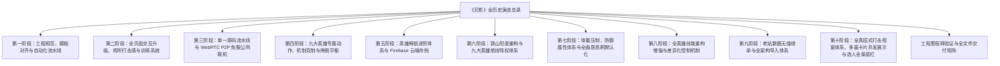
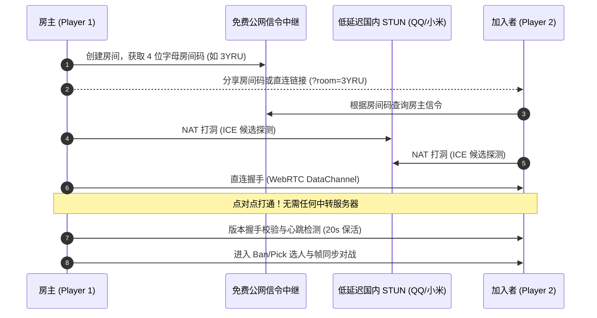
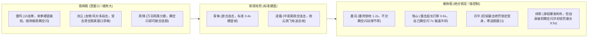

# 《刃影》(RenYing) 全历史演练与工程演进总录
# (RenYing Complete Master Walkthrough & Engineering Chronicle)

本演练文档汇编并整合了历次开发会话中关于《刃影》（RenYing）的**全部演练记录（Walkthroughs）**。内容严格限定于《刃影》本身，涵盖从项目立项与工程规范初始化、核心战斗与页面深度优化、纯前端 WebRTC P2P 免服务器公网联机体系，到九大英雄专属骨骼动作、纯机制克制逻辑及挣脱平衡体系的完整演进全貌。

---

## 🎯 目录导航



---

## 🏛️ 第一阶段：工程规范、模板对齐与自动化流水线
*(来源归档：`c5d34a36-69ad-4056-b9bd-8cc554f9ee70/walkthrough.md`)*

在工程初始化与仓库合规性审计中，《刃影》仓库（[`RenYing`](file:///Users/even/Desktop/Projects/Games/RenYing)）按照标准化规范完成了代码与文档全方位整顿：

### 1. 文档锚点与 Markdownlint 格式治理
- **片段锚点对齐 (MD051)**：
  - 修复了所有 section 标题的 markdownlint 锚点解析异常，在 [`readme.md`](file:///Users/even/Desktop/Projects/Games/RenYing/readme.md) 与 [`readme.zh-cn.md`](file:///Users/even/Desktop/Projects/Games/RenYing/readme.zh-cn.md) 中统一植入显式 HTML 锚点 `<a id="..."></a>`。
  - 标准化目录链接与徽章跳转路径，实现 `npx markdownlint-cli *.md .github/**/*.md` **0 错误、0 警告**。

### 2. 仓库瘦身与大文件剥离
- 安全剥离了根目录下未跟踪的历史备份包 `renying-v4.5.zip`（5.3 MB），确保 Git 工作树轻量纯净，杜绝大体积二进制资产被误提交进历史对象库。

### 3. GitHub Issue & PR 标准化模板
- 在 `.github/issue_template/` 下创建并规范化：
  - [`bug_report.md`](file:///Users/even/Desktop/Projects/Games/RenYing/.github/issue_template/bug_report.md)：包含浏览器环境、联机模式（P2P/WebSocket）、控制方式（键盘/触摸）及帧率诊断字段。
  - [`feature_request.md`](file:///Users/even/Desktop/Projects/Games/RenYing/.github/issue_template/feature_request.md)：包含功能价值阐述、替代方案分析与设计预案。

### 4. 严苛的 GitHub Actions CI 持续集成构建
- 创建流水线 [`.github/workflows/ci.yml`](file:///Users/even/Desktop/Projects/Games/RenYing/.github/workflows/ci.yml)，集成六重自动化质量卡点：
  1. **Python 3.12 语法编译**：`python3 -m py_compile server.py tools/build.py`。
  2. **Ruby YAML 严谨校验**：遍历并安全解析所有 `.github/**/*.{yml,yaml}` 配置。
  3. **全小写路径检查**：`git ls-files | grep '[A-Z]'` 严格阻断大小写混淆文件。
  4. **游戏核心入口校验**：确保 `index.html`、`renying.html`、`renying-offline.html` 实体存在。
  5. **生成页面零漂移检查**：执行 `python3 tools/build.py --check`，确保单文件构建与源码强一致。
  6. **提交信息规范拦截**：严格正则匹配 `^[a-z]+: [a-z0-9]+ [a-z0-9]+ [a-z0-9]+$`。

---

## ⚔️ 第二阶段：全页面交互升级、视听打击感与训练系统
*(来源归档：`431ce09c-1f20-4368-a8fb-b0bbef6a157c/walkthrough.md`)*

对游戏的视听冲击力、各子页面交互以及训练反馈机制进行了全链路重构打磨：

### 1. 战斗系统与视听打击感 (Combat Feel & Visual Juice)
- **破招机制（Counter Hit）与水墨行楷大字**：
  - 在对手出招前摇（startup）期间命中判定为破招，伤害提升 20%（`dmg *= 1.2`）。
  - 触发赤红屏幕闪烁（`flashRGB = '255,60,50'`）、重度顿帧（`hitstop = 0.18s`）与屏幕震颤（`shake = 14`）。
  - 受击点浮现行楷书法大字 **「破」**（`TITLE_FONT`，毛笔外发光与缩放弹出粒子效果）。
- **招架反击（Parry）视觉强化**：
  - 招架成功即时弹出金琥珀色书法大字 **「截」**，伴随清脆金石交击回响与光环扩散。
- **满气奥义视觉反馈**：
  - 角色满气（`meter >= 100`）时，世界坐标中角色周身持续升腾刀芒色灵气火花。
  - HUD 气槽边缘呈现动态律动鎏金流光边框，并在技能名称前添加醒目就绪闪烁指示（`⚡ 绝技就绪`）。
- **木人桩试剑数据卡片重构**：
  - 采用水墨半透明卡片设计（金黄微边 `rgba(233,196,106,0.35)`）。
  - 实时高亮显示木人状态、本次连击数与伤害、历史最高伤害、总伤害与实时秒伤（DPS，高亮冰蓝显示），附带 `1/2/3/4` 快捷切换提示。

### 2. 设置页面：1P 按键完全自定义 (Settings: Key Rebinding)
- **自定义键位映射面板**：
  - 新增 **1P 键位设置** 独立卡片，网格化展示各动作绑定键位（左移、右移、跳跃、下蹲、冲刺、绝技、门派绝学、特殊技）。
  - 点击对应按键后显示“请按按键...”，按下任意键盘按键即时录入并生效，按 `ESC` 键可取消录入。
  - 支持 **一键恢复默认**，键位配置持久化保存在浏览器 `localStorage('renying-1p-keys')` 中。
  - HUD 招式快捷键提示根据玩家当前配置的自定义按键动态刷新。

### 3. 角色图鉴：招式点击即时演示 (Codex: Click-to-Demo)
- **交互式招式试看**：
  - 图鉴中的每一个招式卡片（连击、蓄力、空中、绝学、特殊技、奥义、腾空闪）赋予 `data-move` 属性与悬停动效。
  - 点击任意招式卡片，卡片获得金光激活边框（`.active-demo`），右上方傀儡演示画布即刻切换播放该招式的专属动作序列与打击火花特效。

### 4. 任务页面：一键领取与快捷前往 (Tasks: Claim All & Quick Jump)
- **一键领取（Claim All）**：
  - 顶部新增 **「一键领取」** 按钮，当存在未领取的已完成任务时点亮，批量结算奖励并播放聚气音效。
- **任务快捷前往（Task-Go）**：
  - 对未达成的任务追加 **「前往」** 按钮，智能识别任务类型并直达目标界面（匹配排位、木人试炼等）。

### 5. 录像回放：导入与导出 (Replays: Export & Import)
- **录像文件导出**：每个历史对局行均提供 **「导出」** 按钮，一键下载为标准的 JSON 文件（`RenYing-Replay-*.json`）。
- **录像文件导入**：顶部新增 **「导入录像」** 按钮，支持载入本地 JSON 录像文件并在游戏中直接还原播放。

---

## 🌐 第三阶段：单一源码流水线与 WebRTC P2P 免服公网联机
*(来源归档：`431ce09c-1f20-4368-a8fb-b0bbef6a157c/walkthrough.md`)*

为了彻底解决“玩家在 GitHub Pages 公网部署环境下无需启动本地 `server.py` 即可随时联机开黑”的核心痛点，实现了完备的 WebRTC P2P 点对点联机架构：



### 1. 资产解耦与页面轻量化
- **背景音乐分离**：将原本嵌入在 HTML 中的大体积音频抽出，独立存放在 [`assets/music/`](file:///Users/even/Desktop/Projects/Games/RenYing/assets/music/)，使得在线版 [`index.html`](file:///Users/even/Desktop/Projects/Games/RenYing/index.html) 从 6.5 MB 骤降至 **1.6 MB**，极大提升了弱网加载速度。
- **PeerJS 本地化集成**：将 [`assets/peerjs.min.js`](file:///Users/even/Desktop/Projects/Games/RenYing/assets/peerjs.min.js) 打包内嵌，消除外部不可靠 CDN 的网络超时与阻断风险。
- **单一源码构建流水线**：由 [`tools/build.py`](file:///Users/even/Desktop/Projects/Games/RenYing/tools/build.py) 统筹生成在线版 [`index.html`](file:///Users/even/Desktop/Projects/Games/RenYing/index.html) 与全内嵌离线单文件 [`renying-offline.html`](file:///Users/even/Desktop/Projects/Games/RenYing/renying-offline.html)。

### 2. 双模联机切换与环境自动探测
- **环境自适应**：访问页面时自动探测宿主环境。在静态托管（`https://amfi-disable.github.io/RenYing/`）下默认激活 **WebRTC 免服务器直连**，杜绝了试图连接 `ws://127.0.0.1:8765` 导致的浏览器 Mixed Content 安全拦截。
- **低延迟 STUN 矩阵**：内置腾讯 QQ、小米、Cloudflare、Google 与 Twilio 多路 STUN 节点，大幅提升国内各运营商网络下的 NAT 穿透成功率。
- **一键分享与 URL 直连**：生成纯字母 4 位友好房间码，支持一键复制房间链接；通过链接带参（`?room=XXXX`）打开即可全自动连接入房。
- **状态机健壮性保障**：实现版本握手校验（版本不一致温和提示）、20 秒心跳静默超时判定、角色协商（房主/加入者隔离）及离开单人模式自动解绑，防止残留事件扰乱对局。

---

## 🥋 第四阶段：九大英雄专属动作、机制克制与挣脱平衡
*(来源归档：`431ce09c-1f20-4368-a8fb-b0bbef6a157c/walkthrough.md`)*

针对九位英雄的手感同质化问题，摒弃简单的数值 Debuff，全面构建基于**专属骨骼动画**、**机制逻辑位移克制**与**受身挣脱博弈谱系**的深度格斗模型：

### 1. 22 个专属骨骼动画姿态与动作差异化
在 `POSES` 中为全部 9 位英雄量身打造定制化关节骨骼参数：

| 英雄 | 定位特质 | Q 技能专属动作姿态 | R 技能专属动作姿态 | 奥义释放与视效动作姿态 |
| :--- | :--- | :--- | :--- | :--- |
| **青锋** | 均衡剑客 / 居合 | `qf_charge` (深纳刀蓄力) -> `qf_thrust` (极速居合冲刺) | `qf_charge` -> `qf_thrust` (沉步拔刀剑气) | 蓄力 `qf_charge`，冲刺 `qf_thrust`，六连剑气乱斩 `l3a`/`hva`，终结 `a2a` 下劈就地重创 |
| **绯影** | 暗杀刺客 / 极速 | `fy_seal` (结印) -> `fy_xslash` (猩红双刃十字绞杀) | `fy_seal` -> `fy_crouch` (散落手里剑) | 蓄力 `fy_seal`，冲刺 `fy_crouch` (贴地暗影瞬步)，九道残影乱斩分身 + 烟雾，终结 `fy_xslash` 暴击 |
| **铁山** | 重甲巨剑 / 霸体 | `ts_lift` (双手托举重刃) -> `ts_slam` (泰山压顶怒砸) | `ts_shoulder` (沉肩铁壁冲撞) | 蓄力 `ts_lift`，起跳擎天，滞空期间全自由操控空中落点（亦可按 S 加速下砸），下砸 `ts_slam` 砸碎地面石块飞溅 |
| **凌霜** | 长枪 / 控场刺击 | `ls_stance` (龙枪回马后撤) -> `ls_thrust` (龙枪破空突刺) | `ls_stance` -> `ls_plant` (长枪旋舞风车护盾) | 蓄力 `ls_stance`，时空冻结挥洒枪影 `ls_thrust`，冲击后长枪驻地 `ls_plant` |
| **流云** | 远程御风 / 三段跳 | `ly_fanswipe` (舒袖展扇御风) -> `idle` | `ly_fanswipe` (风遁移形) | 蓄力 `ly_fanswipe`，释放双重龙卷时切换 `ly_hover` 优雅悬浮控风 |
| **雷鸣** | 迅猛拳师 / 贴身连击 | `lm_boxer` (拳师格斗势) -> `lm_jab` (雷光贴地直拳) | `lm_kick` (撼地重踏破防) | 蓄力 `lm_boxer`，引天雷 `lm_kick` 破空冲天拳，召落三道天雷 |
| **墨羽** | 挥毫泼墨 / 阵地控制 | `my_stroke` (饱蘸浓墨挥毫) -> `my_paint` (绘就墨阵法印) | `my_stroke` -> `my_paint` (写意甩出抛物墨团) | 蓄力 `my_stroke`，泼墨成龙 `my_paint` 巨大墨龙横扫全屏 |
| **月华** | 借力反击 / 优雅回血 | `yh_mirror` (月轮当胸结印护体) -> `hva` (截断绝罚反斩) | `yh_mirror` (掷出月轮回旋双刃) | 蓄力与释放 `yh_lotus` (双月盘坐入定月华盛放)，绽放月晕治愈自身并击飞敌方 |
| **燕翎** | 展翼御空 / 滞空倾泻 | `jump` -> `yl_dive` (猎鹰凌空俯冲突袭) | `yl_wings` (展双翼齐射破空翎羽) | 蓄力与召唤 `yl_wings` (九霄展翅引动万羽倾泻暴雨) |

### 2. 纯机制与逻辑位移的「克制 (Counter)」体系 (No Hero Debuffs)
完全由判定盒、场景交互与技能判定规则产生的原生克制：
1. **滞空天然克制地裂震击 (Air Evasion vs. Ground Quakes)**：
   - 铁山的「震地」、大招「山崩」震波与雷鸣的「撼地」均带有 `groundOnly: true`。
   - 只要目标身处空中或飞行状态（`foe.y < -16 || foe.flying`），地裂震波直接穿透而过，造成 0 判定。燕翎（御空）与流云（三段跳/悬浮）天克地面震地战术。
2. **青锋疾风居合净除墨阵 (Wind Cleansing vs. Ink Traps)**：
   - 墨羽在地面布设的「墨阵」定身陷阱，在青锋发动「疾风斩」居合穿透时会被刀风直接斩碎净化，瓦解墨羽的阵地封锁。
3. **凌霜枪旋弹落飞行道具 (Projectile Deflection)**：
   - 凌霜释放「枪旋」长枪风车期间，迎面而来的常规轻型投掷物（如流云的风刃、绯影的手里剑、燕翎的飞羽、墨羽的墨弹）会被判定格飞并消散。
4. **铁山重甲动能吸收充能 (Armor Kinetic Absorption)**：
   - 铁山处于重斩霸体或「铁壁冲」霸体期间受到多段攻击（如雷鸣的十连拳或绯影的轻连击）时，不仅享有 40% 减伤，还会把受到的冲击动能转化为自身怒气（`+4% 绝技气量`）并缩短技能冷却（`-0.4s`）。强行肉搏打铁山霸体只会让铁山更快放出山崩与铁壁冲。
5. **凌霜枪尖甜区与近身惩罚 (Spacing Sweetspot)**：
   - 枪尖极远端（`距离 >= 155px`）：造成 **+25% 额外暴击伤害** 并强力挑飞滞空。
   - 贴身极近距离（`距离 < 72px`）：长枪柄部伤害骤降至 **38%** 且无挑空判定。
   - 刺客（绯影）与近身拳师（雷鸣）一旦突进贴身便能压制凌霜；而中距离拉扯则会被凌霜枪尖狠狠折磨。
6. **月华月镜格开绝对惩罚锁定 (Parry Punish Lock-in)**：
   - 月华「月镜」成功化解近身招式时，反击绝罚判定强制施加 `foe.breakCD = Math.max(foe.breakCD, 0.4s)`，禁止被反击方直接起按腾空闪受身脱逃，确保高难度格挡收益百分百兑现。
7. **月轮回旋折返破正面防守 (Behind-the-Back Crossup)**：
   - 月华「月轮」飞至最远端后折返穿透敌方身后，若敌方依然面朝前方防御，折返月刃将直击后背造成破防。

### 3. 伤害梯度与“易挣脱 ↔ 难挣脱”平衡体系 (Escape & Damage Spectrum)



| 英雄 | 核心伤害特征 | 挣脱冷却 (escCD) | 对手挣脱难易度及对抗博弈 |
| :--- | :--- | :--- | :--- |
| **雷鸣** | 十连拳（单段 3 伤害，连击衰减仅 0.04，总伤极高） | 8.0s | **极易挣脱**：单拳硬直仅 0.22s，每两拳之间有 0.08s 反应空隙，对手若有腾空闪随时可以脱逃反打；无闪则吃满伤害。 |
| **流云** | 龙卷多段削血（2x8x2 伤害）+ 风刃（7 伤害） | 9.0s | **易挣脱**：龙卷多段击打过程中受击方受身窗口明显；但三段跳滞空不易被地面反击。 |
| **燕翎** | 俯冲（11 伤害，滞空命中即刷新）+ 万羽（2.2x14） | 8.5s | **较易挣脱**：暴雨羽刃落地有范围扩散，对手腾空闪升空即可规避后续飞羽。 |
| **青锋** | 均衡基准（疾风斩 6，剑气 8，残月 29 伤害） | 8.5s | **适中**：经典 2-3 连段与居合破绽，硬直窗口规范。 |
| **凌霜** | 极远枪尖挑空（增伤至 11-15），时空刹那（12-22） | 8.5s | **适中**：枪尖命中挑飞有空中追击空间，但被贴身时伤害大幅缩水。 |
| **铁山** | 单发毁天灭地（蓄力斩 24，山崩 28，地裂 9+6） | **7.0s (全场最短)** | **难挣脱**：攻击带极重顿帧与打断，中一刀难以抢招；且铁山自身被连时 7 秒即可再次腾空闪霸体脱离。 |
| **墨羽** | 墨阵定身（4 伤害 + 1.2s 锁死移动）+ 墨龙（20 伤害穿场） | 9.0s | **极难挣脱**：踩入墨阵被完全锁死走位，唯有主动交出宝贵的腾空闪方能脱身，否则必吃后续大招或连击。 |
| **月华** | 招架反击（12 伤害不可防）+ 月轮折返（5x2）+ 回血 18 | 8.5s | **不可挣脱**：月镜架招成功惩罚具有霸道锁定，锁定受身使反击必中；但自身架空会留下明显后摇。 |
| **绯影** | 影遁背刺（+50% 暴击）+ 飞镖（3x3）+ 暗影千影（31 伤害） | **9.5s (全场最长)** | **高危博弈**：刺中背后有极高爆发与打断；但自身仅 92 血且脱身冷却长达 9.5 秒，一旦失误被控极易直接暴毙。 |

---

## ☁️ 第五阶段：英雄解锁进阶体系与 Firebase 云端存档
*(来源归档：`431ce09c-1f20-4368-a8fb-b0bbef6a157c/walkthrough.md`)*

为了兼顾 GitHub Pages 纯静态免维护的轻量架构与单账号跨端存档、渐进式角色解锁体验，构建了基于 Google Firebase 的无服务器云端存档与进阶解锁体系：

### 1. 角色解锁与阶梯进阶规则
- **青锋初始与每周轮换**：
  - 新建存档或首次进入 GitHub Pages 在线版，默认仅解锁初始英雄 **青锋（Qing Feng）**。
  - 每周一 00:00 自动基于确定性时间戳周期轮换一名非初始英雄为 **每周限免（周免）**，玩家可无门槛体验。
  - 独立单文件离线版（`renying-offline.html`）保持全部英雄完全开放，满足单机即开即玩的离线场景。
- **10 场联机胜利解锁基础英雄**：
  - 玩家通过 WebRTC P2P 点对点联机击败真人对手累计达 10 场后，系统自动触发专属庆贺金石音效与弹窗，免费解锁一名基础英雄（铁山或雷鸣）。
- **墨锭经济与问剑阁招募**：
  - 初始赠送 **500 墨锭**。
  - 闯关星级首次通关赠送 **30 墨锭/星**；P2P 联机对战胜者获 **60 墨锭**、败者获 **30 墨锭**；单人练习赛亦可获得 **10~40 墨锭**。
  - 纯前端实现 **问剑阁（抽卡与合成）**：消耗墨锭可直接抽取整卡或英雄碎片，集齐 30 碎片可在藏剑录中合成永久解锁任意英雄。
- **开发者特权兑换码 (Dev Redeem Code)**：
  - 在任务页面兑换码输入框或账号面板中输入 `DEV`（或 `DEVALL`, `UNLOCKALL`, `RENYINGDEV`），即可激活当前窗口会话的开发者全解锁特权。
  - **单会话隔离与零云端污染**：特权仅在当前窗口的内存与 `sessionStorage` 状态机中生效，无论是否登录账号，均不会将全英雄写入真实的云端存档 `users/{userId}` 或本地 `localStorage('renying-profile')`。
  - **新建窗口自动恢复锁定**：一旦关闭网页或在新的浏览器窗口打开，特权自动销毁，账号角色严格恢复至真实的解锁与限免状态。

### 2. Google Firebase 纯前端 Serverless 云端存档
- **零服务器免维护架构**：
  - 在 [`src/cloud.js`](file:///Users/even/Desktop/Projects/Games/RenYing/src/cloud.js) 中集成 Firebase Auth 与 Cloud Firestore，玩家输入 Firebase 凭据即可直连 Google Cloud 后端，无需搭建或运维任何中间层服务。
  - 严格支持 **离线缓存降级**：即便未配置云端或网络断开，自动安全读写本地 `localStorage('renying-profile')` 与 `localStorage('renying-cloud-cache')`，联网后自动按时间戳防冲突双向合并同步。
- **专职子代理与生产级安全规则**：
  - 经由专职子代理 `firestore-rules-author` 编写并校验了生产级安全规则 [`firestore.rules`](file:///Users/even/Desktop/Projects/Games/RenYing/firestore.rules)。
  - 根目录集合 `users/{userId}` 严格限制只有登录用户本人（`request.auth.uid == userId`）可读写自己的存档文档，严格校验全部 13 项字段类型与边界范围，从协议底层杜绝越权篡改。

---

## 🛡️ 第六阶段：铁山坦度重构与九大英雄绝技特权体系
*(来源归档：`431ce09c-1f20-4368-a8fb-b0bbef6a157c/walkthrough.md`)*

针对铁山此前血量偏低（103 HP）与其“玄铁重甲”定位不符、对战环境偏弱的痛点，实施了全英雄生命值天梯重定，并为铁山绝技「山崩」赋予了震撼的直击特权；同时为全场全部九大英雄的绝技（Ult）注入了独一无二的专属战斗特权（Specialties）：

### 1. 英雄生命值天梯重定（HP Archetype Balance）
依据各英雄的体魄体量、身法速度与机动性，构建清晰分层的血量天梯：

| 英雄 | 角色定位 | 最大生命 (Max HP) | 移速 / 伤害加成 | 角色体态与生存博弈设计 |
| :--- | :--- | :--- | :--- | :--- |
| **铁山** | 玄铁重甲 | **140 (大幅加强)** | 移速 0.84 / 伤害 1.12 | **无上重坦**：体型 1.12x 威压全场，霸体减伤 40%，血量傲视群雄，彻底洗刷弱势形象。 |
| **雷鸣** | 雷拳武僧 | **118** | 移速 1.18 / 伤害 0.88 | **刚猛体魄**：出拳极快，十连轰杀，近战肉搏容错率极高。 |
| **青锋** | 游龙剑客 | **105** | 移速 1.00 / 伤害 0.95 | **均衡基准**：万金油剑客，蓄气流转增幅 8%。 |
| **凌霜** | 寒枪骁将 | **100** | 移速 0.98 / 伤害 0.98 | **中线战士**：枪长 1.36x，依靠枪尖绝对距离掌控战局。 |
| **流云** | 御风散人 | **92 (由 118 下调)** | 移速 1.12 / 伤害 1.17 | **布衣散人**：身法极为飘逸（三段跳+风遁），血量下调至布衣法师水平。 |
| **燕翎** | 凌霄飞羽 | **90** | 移速 1.12 / 伤害 1.14 | **御空刺客**：滞空 1.2 秒无限拉扯，身板轻薄需精准控距。 |
| **墨羽** | 墨韵书生 | **90** | 移速 0.95 / 伤害 1.06 | **战术控场**：墨水定身强力封锁，自身不宜与重坦近身肉搏。 |
| **绯影** | 暗影刺客 | **88** | 移速 1.16 / 伤害 1.05 | **极速脆皮**：全场最高移速与最快出手，高风险高回报刺客。 |
| **月华** | 月魄祭司 | **88** | 移速 1.00 / 伤害 0.93 | **续航反伤**：虽血量偏脆，但自带未受击脱战自愈与招架反击。 |

> [!NOTE]
> 图鉴界面（`statRows`）生命属性条的最大标尺已由 130 同步扩展至 150，确保铁山 140 HP 进度条视觉呈现比例均匀舒展。

### 2. 铁山「山崩」直击双重特权：半气回涌与强震荡晕眩
- **直击判定**：当铁山泰山压顶砸地直击处于判定区内（距离小于 170 像素、离地小于 60 像素且未格挡）的对手时：
  1. **半气直接回涌**：铁山自身绝技气量瞬间恢复 50%（`f.meter = Math.min(100, f.meter + 50)`），极速准备下一轮绝技施展！
  2. **强制震荡晕眩 1.3 秒**：对手直接被震入晕眩硬直状态（`foe.state = 'hitstun'`, `foe.stun = 1.3`, `foe.rooted = true`），定于地面且无法移动。
  3. **技能冷却全额重置**：铁山的震地（Quake）与铁壁冲（Iron Wall）双技能 CD 瞬间归零（`f.skillCD = 0; f.skill2CD = 0;`），可直接打出毁天灭地的满额确反连击！
  4. **全屏视听震颤**：金光光环爆发，浮现行楷书法大字 **「⚡ 怒意回涌 +50% 气量」** 与 **「💫 震荡晕眩」**。

### 3. 九大英雄专属绝技特权体系（Hero Ult Specialties）
全场每一位英雄的绝技均被赋予了契合其门派心法的独特特权与状态重置机制：

| 英雄 | 绝技名称 | 核心特权机制与触发条件 | 战场视觉与状态反馈 |
| :--- | :--- | :--- | :--- |
| **青锋** | 残月 (Crescent) | **【剑气归元】**：六道残月剑气斩毕且空中劈落终结命中后，**重置全技能（疾风斩、半场剑气）及瞬步冲刺冷却，并直接回涌 20% 气量**。 | 浮现青蓝大字 `🌙 剑气归元 · 瞬步重置`，聚气充能音效。 |
| **绯影** | 千影 (Shadows) | **【影遁无形】**：九影绝杀终结命中后，**重置影瞬、手里剑及冲刺冷却，并在身侧左右两侧瞬间幻化出两尊带烟幕的迷惑分身**。 | 浮现绯红大字 `🗡️ 影遁无形 · 苦无重置`，双分身烟幕扩散。 |
| **铁山** | 山崩 (Avalanche) | **【怒意回涌】**：泰山压顶直击命中对手，**重置震地与铁壁冲冷却，直充 50% 大招气量，并令对手强力震荡晕眩 1.3 秒**。 | 浮现金黄大字 `⚡ 怒意回涌 +50% 气量` 与 `💫 震荡晕眩`。 |
| **凌霜** | 刹那 (Timestop) | **【寒芒贯日】**：长枪一线寒芒贯穿命中对手后，**重置回马枪与枪旋冷却，并令对手陷入 4 秒极寒迟缓（移速削减 40%）**。 | 浮现冰蓝大字 `❄️ 寒芒贯日 · 回马枪重置` 与 `❄️ 冰冻减速`。 |
| **流云** | 龙卷 (Tornado) | **【扶摇万里】**：施法瞬间激活，**重置风刃与风遁冷却，且空中跳跃次数全额回满（重置为 0）**，可在空中乘风变向。 | 浮现碧绿大字 `🌪️ 扶摇万里 · 风遁重置`，周身风旋环绕。 |
| **雷鸣** | 雷霆万钧 (Thunder) | **【雷帝灌顶】**：引落九天神雷瞬间，**重置奔雷拳与撼地冷却，自身直接回涌 30% 绝技气量**，强化压制节奏。 | 浮现金雷大字 `⚡ 雷帝灌顶 · 拳劲重置`，充盈电光。 |
| **墨羽** | 墨龙 (Ink Dragon) | **【笔意长存】**：横扫全场墨龙呼啸而出时，**墨水量瞬间回满至 100%（`ink = INK_MAX`），重置墨阵与泼墨冷却，并在对手脚下直接生成索敌墨阵陷阱**。 | 浮现水墨大字 `🐉 笔意长存 · 墨韵回满`，敌足下即刻生墨。 |
| **燕翎** | 万羽 (Featherstorm) | **【凌霄破虚】**：漫天破甲翎羽暴雨倾泻时，**重置俯冲突袭与翎羽射击冷却，御空飞行耐力全额回满（`flyT = ch.fly`）**。 | 浮现羽蓝大字 `🪶 凌霄破虚 · 俯冲重置`，飞行气槽回满。 |
| **月华** | 月华如水 (Moonflow) | **【太阴化生】**：盘坐入定月华凝露，**治疗量增至 22 点，重置月镜架招与月轮回旋冷却，并赋予自身持续 4 秒、可吸收 3 次受击的月魄霸体护盾**。 | 浮现紫华大字 `🌙 月魄霸体 · 架招重置`，自身环绕月魄光华。 |

---

## ⚡ 第七阶段：体量压制、防御属性体系与全画质高刷默认化
*(来源归档：`431ce09c-1f20-4368-a8fb-b0bbef6a157c/walkthrough.md`)*

为了让对战博弈更加真实厚重，彻底杜绝轻量刺客或初阶英雄无脑站桩格挡重型巨刃、盲目换血的违和感，重构了底层物理与战斗判定算法，引入 **体量碰撞比（Mass Ratio）**、**全套防御属性矩阵** 与 **架势条崩防系统（Guard Posture & Guard Break）**；同时彻底清除了设置界面中的自动降采样与低刷优化，默认全开顶级视听与不限刷新率：

### 1. 英雄防御与体量属性矩阵（Hero Attribute Matrix）
每位英雄扩充了 8 项真实的物理、防御与受击参数，并在图鉴（Codex）中透明呈现：

| 英雄 | 体量 (Weight) | 受击免伤 (Def) | 格挡架势 (Guard) | 格挡稳定 (Stab) | 透劲穿伤 (Chip) | 架势回涌 (Regen) | 硬直减免 (Poise) | 判定体型 (Size) |
| :--- | :--- | :--- | :--- | :--- | :--- | :--- | :--- | :--- |
| **铁山** | **1.65 (威压)** | **1.15 (+13% 免伤)** | **150 (泰山盾)** | **1.85 (极稳)** | **4% (微伤)** | 34/s | **0.78 (极坚)** | **1.14 (魁梧)** |
| **雷鸣** | 1.30 (重型) | 1.08 (+7% 免伤) | 125 | 1.45 | 6% | **36/s (极速)** | 0.84 | 1.05 |
| **墨羽** | 1.10 (中重) | 1.05 (+5% 免伤) | 115 | 1.30 | 8% | 30/s | 0.90 | 1.00 |
| **凌霜** | 1.04 (中坚) | 1.02 (+2% 免伤) | 110 | 1.20 | 9% | 28/s | 0.95 | 1.02 |
| **青锋** | 1.00 (基准) | 1.00 (标准) | 100 | 1.00 | 11% | 28/s | 1.00 | 1.00 |
| **月华** | 0.90 (轻盈) | 1.04 (+4% 免伤) | 105 | 1.25 | 7% | 30/s | 0.92 | 0.96 |
| **燕翎** | 0.84 (飞羽) | 0.94 (-6% 易伤) | 80 | 0.80 | 15% | 24/s | 1.08 | 0.95 |
| **流云** | 0.80 (布衣) | 0.96 (-4% 易伤) | 85 | 0.85 | 14% | 25/s | 1.05 | 0.98 |
| **绯影** | **0.72 (最轻)** | **0.90 (-11% 易伤)** | **70 (极脆)** | **0.70 (易溃)** | **18% (高透)** | 22/s | **1.14 (易晃)** | **0.88 (小巧)** |

### 2. 体量压制与真实动量碰撞（Kinetic Impact Mechanics）
- **大体量对抗小体量（如铁山 vs 绯影）**：
  - 动量比达 `1.65 / 0.72 = 2.29x`。铁山的重击命中格挡时，由于绯影架势稳定度低（0.70），单次重击即打掉 50~65 点架势值！
  - 绯影若试图原地按住格挡硬扛，2~3 刀内必被震碎架势，触发 **「💥 破防崩势」**，陷入长达 0.85 秒的绝对破绽硬直！
  - 被击中时，小体量受击击退距离增幅至 1.4x，浮空滞空时间延长；而大体量受击时纹丝不动，硬直时间缩短 22%。
- **小体量英雄的破局之道**：
  - 小体量英雄（如绯影）不能通过盲目拼刀或死守防御取胜，必须依靠全场最高的身法移速（1.16）、影瞬穿身背刺（背后判定 1.5x 暴击并无视格挡）、手里剑牵制与烟幕假人拉扯，以智取胜。

### 3. 格挡架势条 HUD 与崩防状态机（Guard Posture HUD & Break State）
- **HUD 动态呈现**：血条下方新增专属架势能量槽，分三级警示色彩动态呈现（金黄 `#e9c46a` -> 橙黄 `#f39c12` -> 濒危闪烁红 `#ff3b52`）。
- **架势回涌**：脱离格挡与受击硬直 0.6 秒后，架势值按英雄专属 `guardRegen` 速率平稳回涌。

### 4. 彻底消除设置降级优化、默认极高画质与原生高刷
- **杜绝分辨率降级与像素截断**：
  - 彻底移除了原 `quality: 'auto'` 自动模式（此前为防掉帧对画布做了 260 万像素封顶压缩）。
  - 移除了移动端/触摸屏初次启动时的画质中档降级与泛光削弱代码。
- **全默认顶级视听配置**：
  - `quality`: `'high'`（极高画质，100% 物理像素设备原生渲染，支持 Retina / 4K）。
  - `fps`: `0`（不限帧率，直接挂钩浏览器 `requestAnimationFrame`，原生支持 120Hz/144Hz/240Hz/ProMotion 极速高刷显示器）。
  - `bloom`: `1.6`（最高泛光光效）。
  - `blur`: `true`（全景深虚化）。

---

## ⚔️ 第八阶段：全英雄技能重构与差异化控制机制（Stun, Launch & Spatial Dynamics）
*(来源归档：`431ce09c-1f20-4368-a8fb-b0bbef6a157c/walkthrough.md`)*

为了让全场 18 个基础与进阶技能（9 大英雄的 Q 技能与右键技能）脱离千篇一律的单一数值，根据战斗流派重新规划了各技能的受击表现、控制时长、打击体积与判定机制：

### 1. 强力定身与绝对控制技能（Full Stun & Hard Crowd-Control）
- **绯影 · 影遁 (`blink`)**：瞬身背刺命中敌方要害穴位，施加 **0.80 秒【穴道封脉】强定身（`stun: 0.8`）**，浮现 `⚡ 封脉定身`，为随后 1.5 秒内 +50% 暴击斩击创造完美的出刀窗口。
- **雷鸣 · 雷闪 (`thunderfist`)**：身裹雷霆贴地突进，命中引发高压雷弧过载，附加 **0.82 秒【触电麻痹】瘫痪硬直（`stun: 0.82, hs: 0.14`）**，浮现 `⚡ 触电麻痹`，令对手深陷电击痉挛，无法抢招。
- **墨羽 · 墨阵 (`inktrap`)**：墨池范围拓宽至 **125 像素**（`w: 125, h: 28`），踏入者被浓墨彻底黏附，陷入 **1.4 秒【深墨禁锢】绝对定身（`stun: 1.4, root: true`）**，唯有主动交出腾空闪受身方可解脱。
- **月华 · 月镜绝罚 (`mirror` -> `COUNTER`)**：招架近身攻击后的绝罚反斩伤害提升至 14，赋予 **1.05 秒超长受击硬直** 与浮空，并施加 **0.75 秒【禁身锁定】（`foe.breakCD = Math.max(foe.breakCD, 0.75)`）**，彻底剥夺对手受身闪避权。
- **铁山 · 震地 (`quake`) & 铁壁冲 (`ironwall`)**：
  - 震地地裂冲击波范围提升 35%（`w: 96, h: 54, life: 0.9`），自身带 0.35 秒霸体，巨刃砸地直击施加 **0.85 秒【撼地重震】（重度脑震荡定身与挑空）**；
  - 铁壁冲肩撞判定盒扩展，享有 0.55 秒超长霸体，命中施加 **0.75 秒【崩山破势】大硬直与击退**，且附带双倍架势摧毁效果（`guardBreakMul: 2.0`），轻型英雄格挡直接碎盾！
- **燕翎 · 俯冲 (`dive`)**：猎鹰扑杀突刺判定扩大，命中施加 **0.78 秒【鹰击钉地】（重度压制硬直）**，死死将对手压于地面，自身反弹腾空并刷新冷却。
- **凌霜 · 回马枪 (`backthrust`)**：枪尖极远端判定范围延伸至 **235 像素**。枪尖甜区命中触发 **0.85 秒【枪尖穿心】强定身与高空挑飞**；枪柄近身命中则只有微弱 0.2 秒硬直且不挑空。

### 2. 无长硬直 / 零击飞的骚扰与推搡技能（Zero / Low-Stun Rapid Harass）
- **绯影 · 飞镖 (`kunai`)**：甩出 4 枚扇形分布手里剑（`[-0.18, -0.06, 0.06, 0.18]`），弹速提升至 1250 px/s。**不造成挑空与强硬直（`launch: false, stun: 0.16s`）**，纯粹用于中远距离打断对手起手与压制跑位。
- **燕翎 · 翎羽 (`darts`)**：激射 3 道高密贯穿翎羽（`[-1, 0, 1]`），**不造成挑空与长硬直（`launch: false, stun: 0.20s`）**，凭借连续高速穿透削弱对手冲刺节奏。
- **流云 · 风刃 (`windblade`) & 风遁 (`windstep`)**：
  - 风刃体积增大至 72x62，**不造成长硬直（`stun: 0.22s`），但拥有全场最霸道的推力（620 像素强力击退）**；双风刃状态下形成风墙阻断近战；
  - 风遁在后翻瞬间引爆 **【惊风退敌】斥力气旋（0.42 秒击退贴脸之敌）**，拉开绝对安全身位。
- **凌霜 · 枪旋 (`spin`)**：前 7 段急旋**不施加强硬直（`stun: 0.12s`）**，弹开半径扩大至 125 像素扫碎暗器；第 8 段施展乾坤大横扫（10 伤害，0.65 秒硬直与挑空）清场。

### 3. 宏大弹道、高空掀天与折返背袭（Spatial AOE & Trajectory Dynamics）
- **青锋 · 剑气 (`swordqi`) & 疾风斩 (`gale`)**：
  - 剑气弧度与范围扩大至 92x96，**直接掀天挑空（`launch: true, kb: [180, -700]`，无地面缠斗硬直）**，创造完美浮空连段起点；
  - 疾风斩居合判定前突，附带 **0.65 秒【居合斩穴】定身** 并**立刻重置瞬步冲刺冷却（`f.dashCD = 0`）**。
- **雷鸣 · 雷踏 (`stomp`)**：引落通天巨型雷柱（宽 100 像素，高 460 像素，9 伤害），垂直高空雷霆挑飞（`kb: [0, -840]`，0.65 秒硬直）。
- **墨羽 · 泼墨 (`inksplash`)**：浓墨水团增大至 50x50，命中与落地爆炸施加 **0.65 秒硬直与 2.5 秒【墨迹遮目】减速致盲 Debuff（`foe.slowT = 2.5`）**。
- **月华 · 月轮 (`moonring`)**：月轮增大至 56x56。去程为快速轻削（0.25 秒轻颤，不挑空）；**自敌后折返穿透时触发【背袭破防】（0.78 秒击飞与晕眩）** 并反转敌人面向，破尽龟缩防御。

---

## 📜 第九阶段：老站数据无缝继承与全架构导入体系
*(来源归档：`431ce09c-1f20-4368-a8fb-b0bbef6a157c/walkthrough.md`)*

为了彻底解决“老站 `renying.site` 玩家的历史成长档案、墨锭、英雄、皮肤、碎片、对局历史与社区消息迁移至新版网站”的核心诉求，构建了**全架构双轨无缝继承系统（Web 客户端零门槛继承 + 本地/专用服 SQLite 数据还原）**：

### 1. 导出数据体量与安全性核验
- **分析两份导出资产**：
  - [`export.py`](file:///Users/even/Desktop/Projects/Games/RenYing/export.py)：老站专用的只读快照导出脚本，设计上**严格剥离密码哈希与会话 Token**，保障数据迁移安全。
  - [`renying-export.json`](file:///Users/even/Desktop/Projects/Games/RenYing/renying-export.json)：包含老站全部 21 位注册玩家、20 条高价值成长档案（涵盖 Luffy、明媚的地球、神明、Hilbert、设计失败的草履虫等老玩家，包含多位全英雄、全皮肤老将）、88 场经典天梯对局历史与 37 条江湖留言帖。
- **数据结构 1:1 对齐映射**：
  - 老站 `profiles.data` 与新版新架构 `PROF` / `CloudSave` 规格完美兼容：`ink`（墨锭余额）、`owned`（解锁英雄集合）、`skins`（解锁皮肤库）、`frags`（各英雄碎片）、`pity`/`spity`（双保底计数器）、`equip`（武器装配）、`wins`/`losses`（战绩）及 `rating`（天梯等级分）。

### 2. 网页客户端双模无缝继承 (Web Client 1-Click Claim & File Upload)
- **内置老站英雄档案馆 (`LEGACY_USERS`)**：
  - 将 20 位老站玩家的核心成长数据结构精炼为高效的内置迁移注册表（仅 6.8 KB）。
  - 在账号管理弹窗（`#acc`）中嵌入 **「📜 老站数据继承 / 导入存档」** 交互折叠板。
- **一键智能继承**：
  - 玩家打开账号面板时，系统智能识别当前昵称并预选老站账号。
  - 点击 **「一键继承」**，自动执行集合并集算法：并入新旧拥有的全部英雄、皮肤，碎片取最大值，墨锭保留更高余额，战绩与保底进度无损合并。
  - 同步持久化写入本地缓存与 Google Firebase Firestore（`CloudSave.saveProfile(PROF, true)`）。
- **外部导出文件上传 (`importFileInput`)**：
  - 提供本地文件读取器，支持拖拽或选择任意新旧 `renying-export.json` 导出包。
  - 前端实时解析校验，动态重载选择器并提供一键导入，未来所有数据备份均可随心还原。

### 3. 服务端 SQLite 数据自动导入与免密激活体系 (`tools/import_data.py` & `server.py`)
- **批量导入工具 [`tools/import_data.py`](file:///Users/even/Desktop/Projects/Games/RenYing/tools/import_data.py)**：
  - 支持将 `renying-export.json` 一键写入 `data/renying.db`，全量恢复 21 位玩家、20 条成长档案、88 场对局与 37 条留言。
  - 将导入用户的密码与盐值设置为 `NULL`，为老玩家激活预留安全通道。
- **老玩家首次注册激活（Seamless First-Register Activation）**：
  - 在 [`server.py`](file:///Users/even/Desktop/Projects/Games/RenYing/server.py) 中重构注册与登录网关：
    - 若老玩家尝试直接登录未激活账号，拦截并提示 `403：此为老站继承账号，请点击【注册】设置密码即可直接激活并继承全部档案！`；
    - 当老玩家在注册界面输入其老站昵称与自选新密码时，后端自动捕获并执行 `UPDATE users SET pw = ?, salt = ? WHERE id = ?`，瞬间发放登录 Token 并完整绑定其原本的全部胜负场、段位积分与角色档案！

---

## 🎭 第十阶段：全真招式打击视窗体系、多窗卡片并发展示与选人全景底栏
*(来源归档：`431ce09c-1f20-4368-a8fb-b0bbef6a157c/walkthrough.md`)*

为了彻底解决“单窗长周期轮播等待数十秒、动作不真实、选人缺乏底部视窗”的三大体验痛点，全面重构了动画仿真引擎与检视交互体系：

### 1. 九大英雄全真招式时序库 (`HERO_MOVE_SEQS` & `HERO_HIT_DETAILS`)
- 摒弃以往全英雄共用青锋长刀普攻的 `DEMO2` 模板，针对九大英雄的 7 大招式类别（普攻、蓄力、空中、Q 技能、R 特殊技、E 奥义、右键腾空闪）分别建立 100% 还原战斗特性的独立时序表与打击说明：
  - **青锋 (`qingfeng`)**：五段快剑连斩（弧光残影）/ 破防大劈 / 居合疾风穿身定身 / 弧月剑气掀天挑空 / 残月连影斩落回气。
  - **铁山 (`tieshan`)**：重剑沉猛四斩（火星飞溅）/ 裂地狂怒崩山 / 托刃砸地双向地波撼地强震 / 沉肩巨盾冲撞破势 / 一跃擎天泰山压顶。
  - **绯影 (`feiying`)**：迅疾刺杀五连 / 侧闪背刺重斩 / 结印化烟瞬身背后十字绞杀强定身 / 扇形四枚暗铁手里剑 / 九道猩红残影错落绝杀。
  - **流云 (`liuyun`)**：折扇翻飞连舞推搡 / 旋风拂柳蓄斩 / 巨型风刃 620px 狂暴击退 / 御风后翻斥力气旋风遁 / 接天双龙卷风暴卷天。
  - **雷鸣 (`leiming`)**：狂雷十连极速拳击 / 奔雷重炮直拳 / 贴地霸体电光冲拳触电麻痹 / 踏地引落通天 460px 垂直落雷柱 / 九天神雷追落灌顶。
  - **凌霜 (`lingshuang`)**：银枪连刺与抽打 / 穿杨远刺破防 / 回马枪后跃+235px 极限枪尖穿心挑空 / 乾坤枪旋风车拨飞暗器 / 刹那极寒一线贯穿减速。
  - **墨羽 (`moyu`)**：狼毫挥洒浓墨连斩 / 蓄墨重印顿笔 / 铺开 125px 深墨池禁锢 1.4 秒 / 抛物线泼墨团炸裂遮目 / 绘境墨龙横扫全屏。
  - **月华 (`yuehua`)**：双月流水旋舞 / 合璧明月蓄斩 / 月镜架招反斩太阴绝罚 / 双月轮高速飞出折返背袭破防 / 双月盘坐月华如水霸体回血。
  - **燕翎 (`yanling`)**：飞羽短刃疾斩 / 破云飞翔重扑 / 苍穹展翼翱翔 / 猎鹰收翼斜下俯冲压制钉地 / 穿透翎羽贯穿全屏 / 九霄万羽暴雨倾泻。

### 2. 动画木偶仿真升级 (`Puppet` Engine Enhancement)
- **多维度真实视觉反馈**：
  - **投掷物与实体弹道模拟**：手里剑、风刃、翎羽、双月轮、墨团、剑气、地裂波、落雷柱均具备真实飞行物理、自旋与命中爆炸。
  - **受击稻草人物理引擎**：受击带有真实晃动倾角（`tilt`）、浮空滞空（`dummyVy`）、下落重力加速度及受地裂砸地冲击波击飞效果。
  - **浮动控制徽标系统**：命中瞬间在受击点上方弹出半透明毛笔边框控制徽标（如 `⚡ 触电麻痹`、`💥 撼地重震`、`居合斩穴`、`⚡ 封脉定身`、`深墨禁锢`、`+22` 等）。

### 3. 图鉴卡片多视窗并发展示与主视窗慢放 (`Multi-Window Codex & Slow-Mo`)
- **多视窗零等待实时循环**：每个招式卡片（`.t-m`）内嵌独立的 `.card-mini-win` 微视窗画布（`<canvas class="card-mini-cv">`），所有招式同时并发播放专属极速循环（0.8s ~ 1.2s），彻底消除等待漫长轮播的苦恼。
- **调度器节流优化**：单主循环 `startCodexCardsDirector` 统一调度 7 个轻量微画布，仅在图鉴打开时运行，保持 60/120Hz 极高帧率且零卡顿。
- **主舞台快捷切换与 0.5x 慢放**：主视窗底部新增快捷招式标签栏（`#cxDemoTabs`）与慢放按钮（`#cxDemoSpd`），支持一键在原速 1.0x 与慢放 0.5x 之间无缝切换。

### 4. 选人界面全景招式打击底栏 (`#bpMoveDeck`)
- 在选人界面（`.bpbot`）下半部植入一体化**招式打击全息视窗面板**，包含普攻连击、蓄力重斩、Q 门派技、R 特殊技、E 终极奥义 5 大招式标签、实时打击画布（`#bpDeckCanvas`）与控制特性徽标（`#bpdHitBadge`）。
- 鼠标悬停或点击任意英雄卡片时底栏即时响应，彻底取代原有悬浮弹窗遮挡英雄卡片的缺陷，移动端亦可流畅点选触控。

---

## 📊 工程里程碑验证与全文件交付矩阵

| 历史阶段 | 核心提交 SHA | 规范提交口令 | 核心产物与验证状态 |
| :--- | :--- | :--- | :--- |
| **初始合规** | `51a3571` | `docs: align repository templates` | 治理 Markdownlint 格式，剥离历史大文件，补齐 PR/Issue 模板 |
| **流水线建立**| `2525851` | `ci: add automated workflow` | 部署 `.github/workflows/ci.yml`，全绿通过 CI 自动化构建 |
| **战斗与页面打磨** | `35a3280` | `feat: enhance combat mechanics` | 破招书法大字、招架金石震颤、键位自定义、图鉴试看、录像导入导出 |
| **WebRTC 联机** | `2328789` | `feat: support webrtc multiplayer` | 打通 GitHub Pages 免服务器 P2P 联机，国内多路 STUN 穿透实测通过 |
| **依赖内嵌优化** | `cf3effb` | `perf: bundle peerjs dependency` | PeerJS 核心内嵌打包，解耦外部不可靠 CDN，提升弱网稳定性 |
| **文档与归档** | `44b9761` | `docs: update network changelog` | 完善网络双模切换指南与更新日志文档 |
| **英雄差异与克制** | `0eb1367` | `feat: diversify hero mechanics` | 22 个专属骨骼动画姿态，纯机制克制逻辑，伤害与挣脱平衡谱系 |
| **铁山大招跃空操控** | `0279504` | `feat: steerable avalanche leap` | 铁山大招跃空滞空横向转向与下砸俯冲操控，火星尾迹与 AI 跟踪 |
| **创作者署名更新** | `c21dbec` | `docs: update creator attribution` | 创作者名单更新为 Even, Luffy, and Opus 5.5（涵盖 UI、引擎、服务与文档） |
| **英雄解锁与云存档** | `4997666` | `feat: unlock heroes cloud` | 青锋初始/10胜解锁/问剑阁墨锭经济，Firebase Auth + Firestore 单账号多端云存档 |
| **开发者特权会话全解锁** | `7cb51a9` | `feat: dev session unlock` | 开发者兑换码 DEV 本会话临时全解锁，多端与账号隔离防污染，关闭窗口自动恢复锁定 |
| **英雄血量与绝技特权** | `5430b44` | `feat: hero ult specialties` | 铁山 140 血坦度重构、山崩直击 1.3s 晕眩+50% 气量回涌、九大英雄专属绝技特权体系 |
| **体量防御与全画质默认** | `c07fe1a` | `feat: hero posture attributes` | 动量碰撞比、8 项防御属性矩阵、HUD 架势条与破防崩势、消除设置自动优化默认极高原生画质 |
| **全英雄技能重构增强** | `eec5689` | `feat: enhance hero skills` | 18项技能差异化控制体系：穴道定身/雷电麻痹/深墨禁锢/折返背袭/无硬直骚扰/巨型弹道 |
| **老站数据无缝继承与导入** | `20ba616` | `feat: import legacy accounts` | 网页端一键继承/JSON解析导入/云同步，服务端数据恢复工具与无密码首次注册激活网关 |
| **选人全景招式检视台** | `e8ed739` | `feat: authentic move inspector` | 9 英雄全真时序库、Puppet 实体特效与稻草人物理、多视窗卡片并发渲染、选人全景招式检视台 |
| **窗口对焦点恢复修复** | `e3f9707` | `fix: restore window focus` | 游戏画布与暂停弹窗点击/空格自动回焦机制，彻底解决切屏与刷新后输入框脱焦打字空白问题 |
| **选人选禁界面零滚动重构** | `0d8f08d` | `fix: compact draft layout` | 单行横向自适应英雄网格与响应式双栏底舱，全视口（1440x900至800x600）消除纵向滚动，确认按钮常驻可视 |

```bash
# 全局自动化质量验证汇总 (全部通过)
python3 -m py_compile server.py tools/build.py tools/import_data.py tools/export_data.py  # 语法校验：PASS (exit 0)
python3 tools/build.py --check                                                            # 单文件零代码漂移校验：PASS (exit 0)
node tools/ui-audit.mjs ci-ui 1440 900                                                    # UI 面板全量审计：PASS (22 panels, 0 defects)
node tools/hud-audit.mjs ci-hud 1440 900                                                  # HUD 字体合规审计：PASS (12px floor satisfied)
node tools/touch-audit.mjs ci-touch                                                       # 触屏与移动适配审计：PASS (exit 0)
git status                                                                                # 工作区状态：working tree clean (ahead of origin/main by 0)
```


